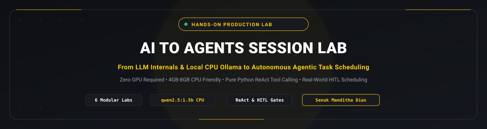
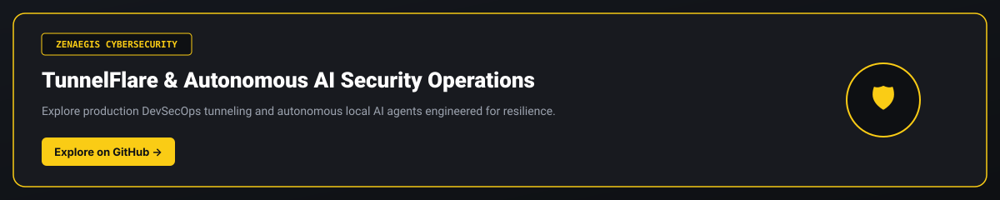
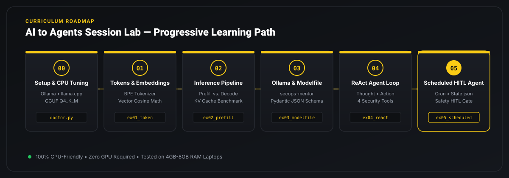

&ensp;
[-FACC15?style=flat-square&logo=cpu&logoColor=0E1013)](./labs/lab-00-setup-and-cpu-tuning.md)&ensp;
&ensp;
&ensp;

🎯 [What You'll Learn](#-what-youll-learn) &ensp; ✅ [Prerequisites](#-prerequisites) &ensp; 🤖 [Model Strategy](#-understanding-the-cpu-friendly-model-strategy-zero-gpu-required) &ensp; 📚 [Course Structure](#-course-structure) &ensp; 📋 [Command Reference](#-ollama--agentic-command-reference) &ensp; 🤝 [Connect](#-connect-with-me)

# AI to Agents Session Lab

> **✨ Learn to master LLM internals, zero-GPU local Ollama deployment, and autonomous agentic task scheduling.**

AI to Agents Session Lab brings cutting-edge artificial intelligence and agentic engineering directly to your terminal and local CPU. Instead of relying on expensive cloud API keys or heavy GPU workstations, you can unpack transformer internals, tokenize text, benchmark Key-Value (KV) cache speedup, build custom Modelfiles, and engineer autonomous ReAct agents without leaving your local environment.

Think of it as having an interactive, zero-cost AI engineering laboratory available 24/7 on any standard laptop (4 GB–8 GB RAM)!

> 📖 **Prefer a web experience?** You can follow this course right here on GitHub, or launch the interactive [Live Bento Web Portal](http://senukdias.me/AI-to-Agents-Session-Lab/) featuring a live RAM & Token Calculator and interactive pipeline visualizers.

This course is designed for:

- **Software Developers & Engineers** who want to build real agents from scratch rather than just calling cloud wrappers
- **Security Analysts & DevSecOps Practitioners** automating threat triage, log auditing, and autonomous response
- **Students & Researchers** seeking a deep intuition for next-token prediction, KV caches, and tool calling on commodity CPU laptops

<a href="https://github.com/SenukDias/TunnelFlare" target="_blank">
  <picture>
    
  </picture>
</a>

## 🎯 What You'll Learn

This hands-on course takes you from zero to productive with modern generative AI internals and local agentic architectures. You'll build pure-Python scripts throughout all chapters, progressively constructing an autonomous security operations auditor with Human-in-the-Loop safety guardrails.

**No GPU or AI hardware required.** If your laptop has at least 4 GB of RAM, you can run every lab smoothly.

**Perfect for:** Developers, security engineers, students, and anyone with basic Python knowledge.

## ✅ Prerequisites

Before starting, ensure you have:

- **Python 3.9+**: Installed on your machine ([Download Python](https://www.python.org/downloads/)) 
- **Terminal basics**: Comfortable with `cd`, `ls` / `dir`, and running Python scripts 
- **Git**: Installed for cloning repository samples ([Download Git](https://git-scm.com/)) 
- **Ollama**: Installed locally ([Download Ollama](https://ollama.com/download)) — covered step-by-step in Lab 00!

## 🤖 Understanding the CPU-Friendly Model Strategy (Zero GPU Required)

All models used in this course are quantized using **GGUF Q4_K_M** (4-bit medium quantization), allowing neural networks to run at full speed on standard x86/ARM CPUs using AVX2 instructions:

| Model | Download Size | RAM Usage | Role in Course | How to Select |
|:-----:|:-------------:|:---------:|----------------|---------------|
| **`qwen2.5:1.5b`** ⭐ | ~986 MB | ~1.5 GB | **Primary Session Model**: Best-in-class JSON schemas & tool calling on CPU | `OLLAMA_MODEL=qwen2.5:1.5b` |
| **`llama3.2:1b`** | ~770 MB | ~1.0 GB | **Fast Benchmark Model**: Sub-second latency for Lab 02 KV Cache experiments | `OLLAMA_FAST_MODEL=llama3.2:1b` |
| **`qwen2.5:0.5b`** | ~390 MB | ~0.8 GB | **Ultra-Low-RAM Fallback**: Automatically selectable on 4 GB RAM laptops | `OLLAMA_MODEL=qwen2.5:0.5b` |
| **`qwen2.5:3b`** | ~1.9 GB | ~2.6 GB | **Power Upgrade**: Optional upgrade for machines with 16 GB+ RAM | `OLLAMA_MODEL=qwen2.5:3b` |

*CPU Optimization Tip:* Setting `OLLAMA_NUM_PARALLEL=1`, `OLLAMA_MAX_LOADED_MODELS=1`, and `OLLAMA_KEEP_ALIVE=5m` ensures your laptop CPU never swaps weights to disk.

## 📚 Course Structure

| Chapter | Title | What You'll Build |
|:-------:|-------|-------------------|
| 00 | 🚀 [Setup & CPU Memory Tuning](./labs/lab-00-setup-and-cpu-tuning.md) | Zero-GPU Ollama installation, GGUF Q4_K_M tuning, `doctor.py` |
| 01 | 🧬 [LLM Theory, Tokens & Embeddings](./labs/lab-01-llm-theory-and-tokens.md) | BPE tokenizer, dense vector embeddings, cosine similarity math |
| 02 | ⚡ [Prompt-to-Answer Pipeline & KV Cache](./labs/lab-02-prompt-to-answer-pipeline.md) | Phase 1 Prefill (TTFT) vs. Phase 2 Decode, KV Cache benchmark |
| 03 | 📦 [Ollama CLI & Custom Modelfiles](./labs/lab-03-ollama-cli-and-modelfile.md) | Packaging `secops-mentor`, system prompts, Pydantic JSON schema |
| 04 | 🤖 [ReAct Agent Loop From Scratch](./labs/lab-04-react-agent-from-scratch.md) | Pure-Python Thought-Action-Observation loop with 4 security tools |
| 05 | ⏱️ [Autonomous Scheduled Agent & HITL Gate](./labs/lab-05-agentic-task-scheduling.md) | Cron scheduling, `agent_state.json` persistence, HITL safety gate |

## 📖 How This Course Works

Each lab follows the same consistent, battle-tested pedagogical pattern:

1. **Real-World Analogy**: Understand complex architectural concepts through intuitive, everyday comparisons
2. **Core Concepts**: Dissect the essential engineering principles and mathematical formulations
3. **Hands-On Examples**: Execute real code, run live benchmarks, and inspect raw API outputs
4. **Assignment**: Practice and extend your skills by completing interactive `# TODO` exercise files
5. **Common Mistakes & Troubleshooting**: Quick fixes for common memory, port, and JSON formatting traps
6. **Key Takeaways & What's Next**: Consolidate your knowledge and preview the next lab

**All code examples are fully runnable.** Every snippet can be executed against your local `http://localhost:11434` instance.

## 📋 Ollama & Agentic Command Reference

| Action | Command | Purpose |
|---|---|---|
| **Start Service** | `ollama serve` | Start local Ollama background server on port 11434 |
| **List Models** | `ollama list` | Display all downloaded local models and sizes |
| **Check Active** | `ollama ps` | View currently loaded models residing in RAM |
| **Pull Primary** | `ollama pull qwen2.5:1.5b` | Download session primary tool-calling model (~986 MB) |
| **Pull Fast Model** | `ollama pull llama3.2:1b` | Download sub-second latency benchmark model (~770 MB) |
| **Build Modelfile** | `ollama create secops-mentor -f Modelfile` | Package custom system prompt & parameters into model |
| **Run Pre-Flight** | `python scripts/doctor.py` | Verify CPU, RAM, port 11434, and dependencies |
| **Verify Repository** | `powershell ./scripts/verify-repo.ps1` | Run full 6-stage automated integrity audit |

## 🙋 Getting Help

- 🐛 **Found a bug or issue?** [Open an Issue](https://github.com/SenukDias/AI-to-Agents-Session-Lab/issues)
- 🤝 **Want to contribute?** Pull Requests are warmly welcome!
- 📚 **Microsoft Learn Curriculum**: Explore official modules on [Fundamentals of Generative AI](https://learn.microsoft.com/en-us/training/modules/fundamentals-generative-ai/?wt.mc_id=studentamb_296178) and [Introduction to Generative AI](https://learn.microsoft.com/en-us/training/paths/introduction-generative-ai/?wt.mc_id=studentamb_296178)

## 🤝 Connect With Me

- 💼 **LinkedIn**: [linkedin.com/in/senukdias](https://www.linkedin.com/in/senukdias)
- 📱 **WhatsApp Channel**: [Join Here](https://whatsapp.com/channel/0029Van2p0gC6ZvfT0TjC10Y)
- 📸 **Instagram**: [@senukdias](https://www.instagram.com/senukdias)
- 👥 **Facebook**: [facebook.com/senukdias](https://www.facebook.com/senukdias)
- 🌐 **GitHub**: [github.com/SenukDias](https://github.com/SenukDias)
- 🛡️ **ZenAegis**: [TunnelFlare](https://github.com/SenukDias/TunnelFlare)

## License

This project is licensed under the terms of the MIT open source license. Please refer to the [LICENSE](./LICENSE) file for the full terms.
