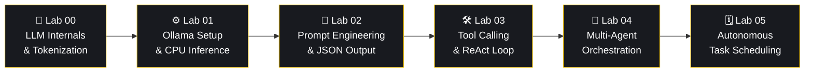

<p align="center"></p>

<p align="center">
  
  
  
  
  
  
</p>

---

# 🤖 AI to Agents Session Lab

**From LLM Internals & Local CPU Ollama to Autonomous Agentic Task Scheduling**

> Created by **[Senuk Manditha Dias](https://github.com/SenukDias)** · Co-Founder & CTO @ [ZenAegis (Pvt) Ltd](https://github.com/SenukDias) · Microsoft Gold Student Ambassador · Microsoft Gold Startup Scout · Cybersecurity Engineer · Creator of [TunnelFlare](https://github.com/SenukDias/TunnelFlare) · 📺 [Ronin Tech Sec](https://youtube.com/@RoninTechSec)

---

## 🗺️ Architecture & Lab Progression



---

## 🏎️ Model Matrix

> All models run entirely on CPU — no GPU required.

| Model | RAM Required | Speed | Quality | Recommended For |
|---|---|---|---|---|
| `qwen2.5:0.5b` | ~1 GB | ⚡⚡⚡ Fastest | ⭐⭐ | 4 GB RAM machines, rapid prototyping |
| `qwen2.5:1.5b` | ~2 GB | ⚡⚡ Fast | ⭐⭐⭐ | **Primary model** — best balance |
| `llama3.2:1b` | ~2 GB | ⚡⚡ Fast | ⭐⭐⭐ | Fast model / tool-call tasks |
| `qwen2.5:3b` | ~4 GB | ⚡ Moderate | ⭐⭐⭐⭐ | 8 GB+ RAM, complex reasoning |

> **4 GB RAM machines:** Set `OLLAMA_MODEL=qwen2.5:0.5b` in your `.env` file.

---

## ⚡ Quickstart

### Prerequisites
- Python 3.10+
- [Ollama](https://ollama.com) installed
- 4 GB RAM minimum (8 GB recommended)

### 5 Steps to Running Your First Agent

**1. Clone the repository**

```powershell
git clone https://github.com/SenukDias/AI-to-Agents-Session-Lab.git
cd AI-to-Agents-Session-Lab
```

**2. Create and activate a virtual environment**

```powershell
# Windows PowerShell
python -m venv venv
.\venv\Scripts\Activate.ps1

# macOS / Linux
python3 -m venv venv
source venv/bin/activate
```

**3. Install dependencies**

```powershell
pip install -r requirements.txt
```

**4. Configure environment**

```powershell
# Copy the example env file
copy .env.example .env

# Edit .env — change OLLAMA_MODEL to qwen2.5:0.5b if you have 4 GB RAM
notepad .env
```

**5. Pull models & verify Ollama is running**

```powershell
# Start Ollama service (if not running)
ollama serve

# In a new terminal — pull the primary model
ollama pull qwen2.5:1.5b

# Optional: pull fast model and fallback
ollama pull llama3.2:1b
ollama pull qwen2.5:0.5b

# Verify models are available
ollama list
```

You're ready. Navigate to any `lab-XX/` folder and follow its `README.md`.

---

## 🧪 Lab Overview

| # | Lab | Topic | Time | Difficulty |
|---|---|---|---|---|
| 🧠 **00** | LLM Internals & Tokenization | Understand tokens, BPE, embeddings, attention, KV cache, temperature, sampling | 45 min | 🟢 Beginner |
| ⚙️ **01** | Ollama Setup & CPU Inference | Install Ollama, pull models, benchmark CPU inference, understand GGUF quantization | 30 min | 🟢 Beginner |
| 💬 **02** | Prompt Engineering & JSON Output | Structured prompting, system roles, forcing valid JSON, error handling | 45 min | 🟡 Intermediate |
| 🛠️ **03** | Tool Calling & ReAct Loop | Implement Reason → Act → Observe cycle, tool dispatch, loop guards | 60 min | 🟡 Intermediate |
| 🤖 **04** | Multi-Agent Orchestration | Planner ↔ Executor ↔ Critic architecture, shared state, agent handoffs | 90 min | 🔴 Advanced |
| 🗓️ **05** | Autonomous Task Scheduling | Cron-driven agentic loops, HITL checkpoints, persistent agent state | 90 min | 🔴 Advanced |

---

## 📚 Microsoft Learn Resources

Deepen your understanding with these curated learning paths:

- 🎓 [**Fundamentals of Generative AI**](https://learn.microsoft.com/en-us/training/modules/fundamentals-generative-ai/?wt.mc_id=studentamb_296178) — Core concepts: tokens, transformers, embeddings, and prompt engineering
- 🛤️ [**Introduction to Generative AI Learning Path**](https://learn.microsoft.com/en-us/training/paths/introduction-generative-ai/?wt.mc_id=studentamb_296178) — End-to-end path from LLM basics to building AI-powered applications

---

## 🏗️ Repository Structure

```
AI-to-Agents-Session-Lab/
├── .env.example          # Environment template — copy to .env
├── .gitignore
├── _config.yml           # GitHub Pages config
├── Modelfile             # Custom secops-mentor Ollama model
├── requirements.txt      # Python dependencies
├── README.md             # This file
├── TROUBLESHOOTING.md    # 8-section debug guide
├── CHEATSHEET.md         # LLM quick reference
├── assets/
│   └── bento/            # Visual assets & hero banner
├── lab-00-llm-internals/
├── lab-01-ollama-setup/
├── lab-02-prompt-engineering/
├── lab-03-tool-calling/
├── lab-04-multi-agent/
├── lab-05-task-scheduling/
└── scripts/              # Shared utility scripts
```

---

## 🔧 Custom Model — SecOps Mentor

Build and run the custom Ollama model included in this repo:

```powershell
# From repo root — creates the secops-mentor model locally
ollama create secops-mentor -f Modelfile

# Test it interactively
ollama run secops-mentor "Analyze this log entry for threats: Failed login from 192.168.1.100 — 47 attempts in 60 seconds"

# Remove when done
ollama rm secops-mentor
```

---

## 🤝 Contributing

Contributions, issues, and feature requests are welcome. Please open an issue before submitting a pull request so we can discuss the change.

---

## 📄 License

MIT License — see [LICENSE](LICENSE) for details.

---

<p align="center">
  Built by <a href="https://github.com/SenukDias"><strong>Senuk Manditha Dias</strong></a><br/>
  Co-Founder & CTO · ZenAegis (Pvt) Ltd &nbsp;|&nbsp; Microsoft Gold Student Ambassador &nbsp;|&nbsp; Microsoft Gold Startup Scout<br/>
  Cybersecurity Engineer &nbsp;|&nbsp; Creator of <a href="https://github.com/SenukDias/TunnelFlare">TunnelFlare</a> &nbsp;|&nbsp; 📺 <a href="https://youtube.com/@RoninTechSec">Ronin Tech Sec</a>
</p>
