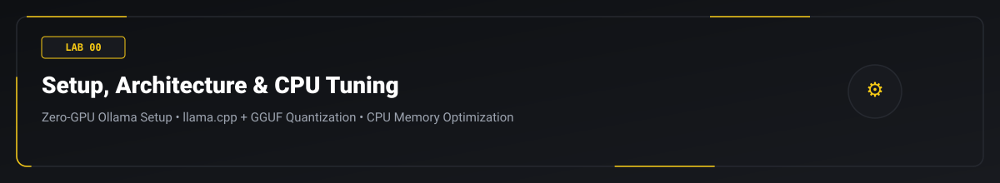
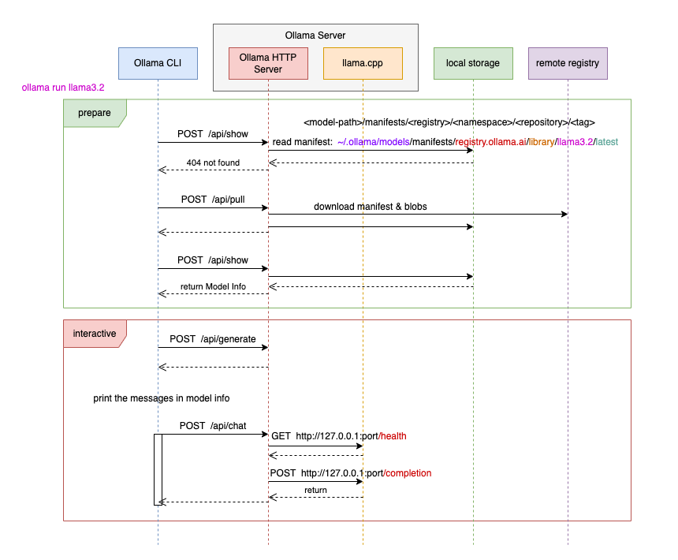

> **Install Ollama, understand how GGUF quantization wraps llama.cpp, tune CPU environment variables, and run pre-flight diagnostics on any standard laptop.**

Welcome to the foundation lab! In this lab, you'll get Ollama installed and optimized on your local CPU machine, pull the lightweight `qwen2.5:1.5b` and `llama3.2:1b` models, and verify that your system is fully configured. No GPU or cloud subscription required. Once your environment is verified with `doctor.py`, the real demos begin in Lab 01!

> ⚠️ **Prerequisites**: Ensure you have Python 3.9+ and Git installed. A laptop with at least 4 GB of RAM is sufficient for this entire course.

## 🎯 Learning Objectives

By the end of this lab, you'll be able to:

- Install and run Ollama as a background service on Windows, macOS, or Linux
- Understand how Ollama wraps `llama.cpp` and serves GGUF quantized models (`Q4_K_M`)
- Configure CPU memory tuning parameters to eliminate disk swapping
- Verify your environment using the automated pre-flight diagnostics suite (`scripts/doctor.py`)

> ⏱️ **Estimated Time**: ~30 minutes (10 min reading + 20 min hands-on)

---

# Real-World Analogy: The AI Engine Under the Hood

<p align="center">
  
</p>

Think of running an LLM like running a high-performance engine:

- **The Raw Weights (FP16)** are like unrefined crude fuel — huge, bulky, and demanding specialized tanker trucks (enterprise GPUs with 80 GB VRAM).
- **Quantization (GGUF Q4_K_M)** is the refinement process — compressing 16-bit floating-point numbers down to 4.5 bits without sacrificing structural integrity, allowing the engine to run on regular unleaded fuel (standard laptop CPU RAM).
- **`llama.cpp`** is the finely tuned mechanical transmission, executing fast tensor matrix arithmetic directly on consumer CPU vector registers (AVX2 / AVX-512 / ARM NEON).
- **Ollama** is the modern dashboard and ignition key — wrapping the low-level engine inside an intuitive CLI and high-speed REST API (`http://localhost:11434`).

---

## Installation

> ⏱️ **Time estimate**: Installation takes 2–5 minutes. Downloading the session models adds another 2–4 minutes depending on your internet connection.

### Windows Installation (Option A: WinGet / Option B: Installer)

Open PowerShell and install Ollama:

```powershell
# Option A: Install via WinGet
winget install Ollama.Ollama

# Option B: Or download the standalone installer directly from
# https://ollama.com/download/OllamaSetup.exe
```

### macOS & Linux Installation

```bash
# macOS via Homebrew
brew install ollama

# Linux via automated shell script
curl -fsSL https://ollama.com/install.sh | sh
```

---

## CPU Memory Tuning (Critical for Laptops)

By default, Ollama may attempt to keep multiple models resident in RAM or handle concurrent requests simultaneously, which can cause severe memory paging and disk swap storms on 4 GB–8 GB RAM laptops.

Configure these three environment variables to lock Ollama into a lightweight, predictable footprint:

```powershell
# Windows PowerShell (Set permanently for current user)
[System.Environment]::SetEnvironmentVariable("OLLAMA_NUM_PARALLEL", "1", "User")
[System.Environment]::SetEnvironmentVariable("OLLAMA_MAX_LOADED_MODELS", "1", "User")
[System.Environment]::SetEnvironmentVariable("OLLAMA_KEEP_ALIVE", "5m", "User")

# Verify the variables are set
Get-ChildItem Env:OLLAMA_*
```

```bash
# macOS / Linux (Add to ~/.bashrc or ~/.zshrc)
export OLLAMA_NUM_PARALLEL=1
export OLLAMA_MAX_LOADED_MODELS=1
export OLLAMA_KEEP_ALIVE=5m
```

| Variable | Recommended Value | Impact on Laptops |
|---|:---:|---|
| `OLLAMA_NUM_PARALLEL` | `1` | Processes one request at a time, avoiding CPU core thrashing |
| `OLLAMA_MAX_LOADED_MODELS` | `1` | Ensures only one model occupies RAM at any moment |
| `OLLAMA_KEEP_ALIVE` | `5m` | Automatically unloads idle models after 5 minutes to release RAM |

---

## See It In Action

### Demo 1: Pulling the Session Models

We will pull our two core models: `qwen2.5:1.5b` (primary model for JSON & function calling) and `llama3.2:1b` (fast sub-second model for pipeline timing experiments):

```powershell
# Pull the session primary model (~986 MB download)
ollama pull qwen2.5:1.5b

# Pull the fast comparison model (~770 MB download)
ollama pull llama3.2:1b
```

<details>
<summary>🎬 See it in action!</summary>

```text
pulling manifest 
pulling 00ba584c3d85... 100% ▕████████████████▏ 986 MB                         
pulling 43070cd41713... 100% ▕████████████████▏  11 KB                         
pulling 0725c88c7849... 100% ▕████████████████▏  244 B                         
verifying sha256 digest 
writing manifest 
success
```

*Your download speed will vary based on your connection.*
</details>

**The takeaway**: Both models combined require under 1.8 GB of total disk storage and run completely offline with zero telemetry.

---

### Demo 2: Pre-Flight Environment Diagnostics (`scripts/doctor.py`)

Run the pre-flight diagnostics script to audit Python version, host RAM, CPU topology, port 11434 availability, and installed packages:

```powershell
python scripts/doctor.py
```

<details>
<summary>🎬 See it in action!</summary>

```text
                                        Pre-flight Diagnostics                 
┌────────────────────────────────┬─────────────────────────────────────────────
│ Check                          │ Detail                                      
├────────────────────────────────┼─────────────────────────────────────────────
│ 1. Python Version              │ Python 3.10+ (Pass)                         
│ 2. Available RAM               │ 4.2 GB free / 16.0 GB total                 
│ 3. CPU Cores                   │ 4 physical cores, 8 logical threads         
│ 4. Disk Space                  │ 15.2 GB free on current drive               
│ 5. Ollama Service Running      │ HTTP 200 OK (http://localhost:11434)        
│ 6. Port 11434 Accessible       │ Connected successfully                      
│ 7. Model qwen2.5:1.5b          │ Present (986 MB)                            
│ 8. Model llama3.2:1b           │ Present (770 MB)                            
│ 9. Python Packages             │ OK: requests, rich, pydantic, schedule      
│ 10. Ollama API Smoke Test      │ Generated 3 tokens in 0.42s                 
└────────────────────────────────┴─────────────────────────────────────────────

🚀 All checks passed! You're ready to start Lab 01.
```
</details>

**The takeaway**: `doctor.py` gives you an instant, automated health report before writing a single line of application code.

---

## 📝 Assignment

### Main Challenge: Verify Zero-GPU Execution

1. Start an interactive session with `qwen2.5:1.5b`:
   ```powershell
   ollama run qwen2.5:1.5b
   ```
2. Ask the model to describe what GGUF quantization is:
   ```text
   >>> Explain what GGUF Q4_K_M quantization means in 2 sentences.
   ```
3. Open a second terminal and inspect active models in RAM:
   ```powershell
   ollama ps
   ```
4. Observe the `SIZE` and `PROCESSOR` column. You should see `100% CPU`!
5. Exit the session by typing `/bye`.

**Success criteria**: `ollama ps` confirms the model is loaded in memory and executing 100% on CPU.

<details>
<summary>💡 Hints (click to expand)</summary>

- If `ollama ps` shows empty, the model may have already unloaded if idle for longer than `OLLAMA_KEEP_ALIVE`.
- Run a quick prompt first, then immediately run `ollama ps` in your second terminal.
- Use `ollama list` to inspect all locally stored model files.
</details>

### Bonus Challenge: Test 4 GB RAM Fallback (`qwen2.5:0.5b`)

If you are running on an older machine with only 4 GB total system RAM:
1. Pull the ultra-lightweight fallback model: `ollama pull qwen2.5:0.5b` (only ~390 MB).
2. Test inference speed: `ollama run qwen2.5:0.5b "Hello!"`.
3. Notice how it loads in less than 500ms even on low-power Intel Celeron or Core i3 processors!

---

<details>
<summary>🔧 <strong>Common Mistakes & Troubleshooting</strong> (click to expand)</summary>

### Common Mistakes

| Mistake | What Happens | Fix |
|---|---|---|
| Running `ollama` commands before starting the service | `connection refused` or `cannot reach localhost:11434` | Launch Ollama from Start Menu or run `ollama serve` in a background terminal |
| Omitting quotes around PowerShell environment setters | Syntax error in PowerShell | Use `[System.Environment]::SetEnvironmentVariable("KEY","VAL","User")` |
| Pulling full FP16 models (e.g. 70B) on a laptop | System freezes, disk thrashing, Out Of Memory | Always stick to `1.5b` or `1b` models for CPU training sessions |

### Troubleshooting

- **Port 11434 already in use**: Another instance of Ollama is already running in the background. Check with `netstat -ano | findstr :11434`.
- **Model pull interrupted**: Re-run `ollama pull qwen2.5:1.5b`; Ollama resumes downloads automatically from the last chunk.
- **Firewall prompt**: Windows Defender may ask to allow Ollama network access. Allow private networks so `localhost:11434` is accessible.

</details>

---

# Summary

## 🔑 Key Takeaways

1. **Ollama bridges high performance and simplicity**: It compiles `llama.cpp` natively for your CPU architecture while exposing an intuitive REST API.
2. **GGUF Q4_K_M is the CPU sweet spot**: Compresses 16-bit parameters to 4.5 bits, reducing RAM consumption by 75% with virtually zero loss in reasoning quality.
3. **Environment tuning prevents swap storms**: Locking `OLLAMA_NUM_PARALLEL=1` and `OLLAMA_MAX_LOADED_MODELS=1` guarantees predictable, responsive performance on any standard laptop.

> 📋 **Quick Reference**: See [CHEATSHEET.md](../CHEATSHEET.md) for a full table of Ollama CLI commands and endpoints.

---

## ➡️ What's Next

Now that your local CPU runtime is tuned and verified, let's explore what actually happens when text enters a neural network!

In **[Lab 01: LLM Theory, Tokens & Embeddings](lab-01-llm-theory-and-tokens.md)**, you'll learn:

- The evolutionary hierarchy from AI to Machine Learning, Deep Learning, GenAI, and Autonomous Agents
- How BPE tokenizers turn strings into numerical indices
- How vector embeddings project semantic concepts into geometric space
- Hands-on token and embedding exploration using `exercises/ex01_token_explorer.py`

---

**[⬅️ Back to Course Home](../README.md)** | **[Continue to Lab 01 ➡️](lab-01-llm-theory-and-tokens.md)**
