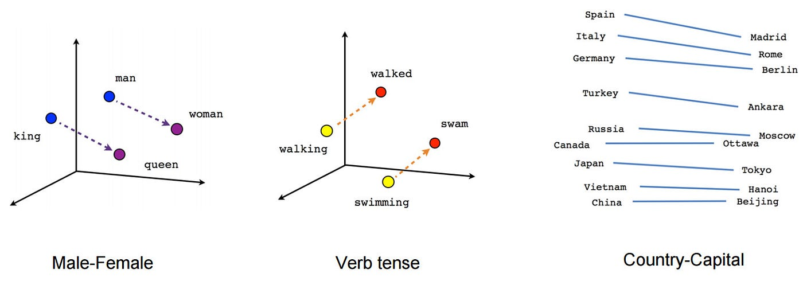

<p align="center">
  
</p>


[⬅️ Previous Lab](lab-00-setup-and-cpu-tuning.md) | [🏠 Home](../README.md) | [➡️ Next Lab](lab-02-prompt-to-answer-pipeline.md)

---

# Lab 01: LLM Theory & Tokens

## 🎯 Learning Objectives

By the end of this lab you will be able to:

- Describe the AI → Agentic AI knowledge hierarchy and where LLMs sit within it
- Explain the three-phase training pipeline: Pre-training → SFT → RLHF
- Demonstrate how BPE tokenization converts raw text into numeric token IDs
- Describe vector embeddings and cosine similarity in plain language
- State the next-token prediction probability formula and explain how it drives generation
- Identify the role of each component in the Transformer architecture
- Run the token explorer exercise and interpret its output

---

## 📚 Theory

### 1. The AI Knowledge Hierarchy

```
╔══════════════════════════════════════════════════════╗
║                   Agentic AI                         ║  ← Tools + Memory + Planning
║  ┌────────────────────────────────────────────────┐  ║
║  │              Large Language Models             │  ║  ← Text generation, reasoning
║  │  ┌──────────────────────────────────────────┐  │  ║
║  │  │         Generative AI                    │  │  ║  ← Images, audio, video, code
║  │  │  ┌────────────────────────────────────┐  │  │  ║
║  │  │  │        Deep Learning               │  │  │  ║  ← Neural networks, backprop
║  │  │  │  ┌──────────────────────────────┐  │  │  │  ║
║  │  │  │  │      Machine Learning        │  │  │  │  ║  ← Stats, feature engineering
║  │  │  │  │  ┌────────────────────────┐  │  │  │  │  ║
║  │  │  │  │  │   Artificial Intelligence│  │  │  │  │  ║  ← Rules, search, planning
║  │  │  │  │  └────────────────────────┘  │  │  │  │  ║
║  │  │  │  └──────────────────────────────┘  │  │  │  ║
║  │  │  └────────────────────────────────────┘  │  │  ║
║  │  └──────────────────────────────────────────┘  │  ║
║  └────────────────────────────────────────────────┘  ║
╚══════════════════════════════════════════════════════╝
```

Each layer **contains** the one below it. Agentic AI extends LLMs with autonomous planning, tool use, and persistent memory — the goal of this lab series.

---

### 2. The LLM Training Pipeline

Training a modern LLM happens in three distinct phases:


#### Phase 1 — Pre-training
- **Data:** Trillions of tokens scraped from the web, books, code repositories
- **Objective:** Next-token prediction (the model learns to predict the next word given all previous words)
- **Result:** A "base model" that can complete text but has no notion of following instructions
- **Compute:** Thousands of GPUs, weeks to months, millions of dollars

#### Phase 2 — Supervised Fine-Tuning (SFT)
- **Data:** Thousands of curated (prompt, ideal-response) pairs written by human annotators
- **Objective:** Same as pre-training, but on instruction-formatted data
- **Result:** A model that understands `[INST] ... [/INST]` or `<|user|>` chat templates
- **Compute:** A fraction of pre-training cost

#### Phase 3 — Reinforcement Learning from Human Feedback (RLHF)
- **Data:** Human preference judgments: "Response A is better than Response B"
- **Process:** Train a **reward model** on preferences, then use PPO to push the LLM toward higher-reward outputs
- **Result:** A model that is helpful, harmless, and honest (HHH)

> [!NOTE]
> The models you use in these labs (Qwen 2.5, Llama 3.2) have all three phases complete. When you give them a system prompt, the SFT phase is what makes them follow it.

---

### 3. BPE Tokenization

Before an LLM sees text, it is converted to **token IDs** — integers that index into the model's vocabulary. The most common algorithm is **Byte-Pair Encoding (BPE)**.

**How BPE works:**
1. Start with individual UTF-8 bytes as the base vocabulary
2. Count which adjacent pairs of symbols appear most frequently in the training corpus
3. Merge the most frequent pair into a new symbol
4. Repeat until vocabulary size is reached (commonly 32k–128k tokens)

**Example — "Hello world" tokenized:**

```
Raw text:   H  e  l  l  o     w  o  r  l  d
            ↓
BPE merge:  "He" + "llo" + " " + "world"
            ↓
Token IDs:  [9906, 1917]   ← (actual Llama 3 token IDs)
```

> [!TIP]
> Run `python exercises/ex01_token_explorer.py` and try the sentence `"cybersecurity"`. You will likely see it tokenized into 2–3 sub-word pieces, because rare domain-specific words are split rather than stored whole.

**Why tokens matter for cost and context:**
- LLMs charge by **tokens**, not words or characters
- A 4096-token context window is roughly 3,000 English words
- Code and technical text are often tokenized less efficiently than English prose

---

### 4. Vector Embeddings

After tokenization, each token is converted to a **dense vector** — a list of floating-point numbers (the "embedding"). Similar tokens end up close together in this high-dimensional space.



**Semantic similarity via cosine similarity:**

```
                    A · B
cos(θ) = ────────────────────────
              ‖A‖ × ‖B‖

Values:
  1.0  → identical direction (very similar meaning)
  0.0  → orthogonal (unrelated)
 -1.0  → opposite direction (antonyms)
```

**Example relationships learned from pre-training:**

```
embed("king") - embed("man") + embed("woman") ≈ embed("queen")
embed("Paris") - embed("France") + embed("Italy") ≈ embed("Rome")
```

The `/api/embed` endpoint in Ollama gives you direct access to these embeddings.

---

### 5. Next-Token Prediction

At its core, an LLM is a function that assigns a probability to every token in its vocabulary given the tokens seen so far:

```
P(w_t | w_1, w_2, ..., w_{t-1})
```

Where:
- `w_t` = the token being predicted at position `t`
- `w_1...w_{t-1}` = all previous tokens (the context)

The model outputs a **logit** (raw score) for each vocabulary token. These are converted to probabilities via **softmax**:

```
P(w_i) = exp(logit_i) / Σ exp(logit_j)
```

Generation is then a **sampling** process — the model picks the next token from this distribution, appends it, and predicts the next one, repeating until an end-of-sequence token is generated.

---

### 6. Transformer Architecture

The Transformer (Vaswani et al., 2017) is the neural network architecture that makes all modern LLMs possible.


**Key components:**

| Component | Role |
|---|---|
| **Token Embeddings** | Convert token IDs → dense vectors |
| **Positional Encoding** | Inject token position information (RoPE in modern models) |
| **Multi-Head Self-Attention** | Allow each token to "attend" to every other token — this is where in-context reasoning happens |
| **Feed-Forward Network** | Per-token non-linear transformation, stores factual knowledge |
| **Layer Norm** | Stabilise training, applied before each sub-layer |
| **Linear + Softmax** | Project from hidden dimension to vocabulary size, produce probabilities |

Modern LLMs stack 32–96 of these Transformer blocks. Each pass through the stack refines the representation until the final layer's output is the next-token probability distribution.

**Interactive visualisation:** Explore attention patterns live at [Transformer Explainer](https://poloclub.github.io/transformer-explainer/)

---

### 7. The Full Prompt-to-Answer Pipeline



```
User text
   │
   ▼
[Tokenizer] ─── text → token IDs
   │
   ▼
[Embeddings] ─── IDs → dense vectors
   │
   ▼
[Transformer Blocks × N] ─── attention + FFN layers
   │
   ▼
[Sampling] ─── temperature / top_k / top_p applied
   │
   ▼
[Detokenizer] ─── token IDs → text
   │
   ▼
Response streamed to user
```

---

## 🔬 Hands-On Steps

### Step 1 — Explore the Token Explorer Exercise

Open `exercises/ex01_token_explorer.py` and read the existing code and TODOs.

```bash
python exercises/ex01_token_explorer.py
```

The script will:
1. Send a sample sentence to Ollama's `/api/generate` endpoint with `"raw": true` to see raw token counts
2. Call `/api/embed` to retrieve the embedding vector for a word
3. Compute cosine similarity between two embedding vectors

### Step 2 — Complete the TODOs

Inside the file, complete the following:

**TODO 1** — Call `/api/embed` and extract the embedding vector from the response:
```python
response = requests.post(
    f"{OLLAMA_HOST}/api/embed",
    json={"model": MODEL, "input": text}
)
# response.json()["embeddings"][0] is the vector
```

**TODO 2** — Implement cosine similarity:
```python
import math

def cosine_similarity(a: list[float], b: list[float]) -> float:
    dot = sum(x * y for x, y in zip(a, b))
    mag_a = math.sqrt(sum(x**2 for x in a))
    mag_b = math.sqrt(sum(x**2 for x in b))
    return dot / (mag_a * mag_b)
```

**TODO 3** — Compare embeddings for `"cybersecurity"` vs `"infosec"` and `"cybersecurity"` vs `"cooking"`. Interpret the scores.

---

<details><summary>💡 Hint 1 — How to call the /api/embed endpoint (Click to expand)</summary>

The `/api/embed` endpoint accepts a single string or a list of strings:

```python
import requests

OLLAMA_HOST = "http://localhost:11434"
MODEL = "qwen2.5:1.5b"

# Single string
resp = requests.post(
    f"{OLLAMA_HOST}/api/embed",
    json={"model": MODEL, "input": "Hello world"}
)
data = resp.json()
# data["embeddings"] is a list of vectors (one per input string)
vector = data["embeddings"][0]   # list of floats, length = model's hidden dim
print(f"Embedding dimension: {len(vector)}")
```

The dimension tells you the model's internal representation size. For `qwen2.5:1.5b` this is typically 1536.

</details>

<details><summary>💡 Hint 2 — What do embedding dimensions mean? (Click to expand)</summary>

An embedding dimension is a learned **feature axis** in the model's internal space. While we cannot give a human label to any single axis (they are abstract), the vector as a whole encodes semantic meaning:

- **More dimensions** = richer representation capacity, but larger memory footprint
- `qwen2.5:1.5b` → ~1536 dimensions
- `llama3.2:1b` → ~2048 dimensions (despite being "smaller" in parameters, it uses a wider embedding)
- GPT-4 is rumoured to use ~12288 dimensions

For cosine similarity to work correctly, **both vectors must come from the same model** — embeddings from different models are not comparable.

</details>

<details><summary>💡 Hint 3 — How to interpret logprobs (Click to expand)</summary>

Add `"logprobs": true` to your `/api/generate` request to see the model's probability for each generated token:

```python
resp = requests.post(
    f"{OLLAMA_HOST}/api/generate",
    json={
        "model": MODEL,
        "prompt": "The capital of France is",
        "stream": False,
        "options": {"logprobs": True}
    }
)
# resp.json()["logprobs"] contains per-token log-probabilities
```

A logprob of `0.0` means probability `1.0` (the model is completely certain). A logprob of `-5.0` means probability `e^-5 ≈ 0.007` (less than 1% confident). Very negative logprobs on many consecutive tokens indicate hallucination risk.

</details>

---

## ✅ Verification

- [ ] `python exercises/ex01_token_explorer.py` runs without errors
- [ ] You can explain why `"cybersecurity"` and `"infosec"` have higher cosine similarity than `"cybersecurity"` and `"cooking"`
- [ ] You understand the difference between a base model and an instruction-tuned model
- [ ] You can describe what RLHF adds to SFT fine-tuning

---

<details><summary>🔧 Common Lab Errors & Fixes</summary>

**`KeyError: 'embeddings'` from /api/embed**
> Ensure you are using Ollama ≥ 0.3.0, which introduced the `/api/embed` endpoint (replacing the older `/api/embeddings`). Update with `winget upgrade Ollama.Ollama` on Windows or `brew upgrade ollama` on macOS.

**Cosine similarity always returns `1.0`**
> You may be comparing a vector with itself. Double-check that your two input strings are different and that you are calling embed separately for each.

**`ConnectionRefusedError` on port 11434**
> Ollama service is not running. See Lab 00 Hint 1 for how to start it.

**Token count seems too high for short text**
> Special tokens (BOS, EOS, role markers) are counted. Use `"raw": true` in the generate request to suppress the chat template and get raw token counts.

</details>

---

📖 **Further Reading:** [Microsoft Learn — Fundamentals of Generative AI](https://learn.microsoft.com/en-us/training/modules/fundamentals-generative-ai/?wt.mc_id=studentamb_296178)

---

[⬅️ Previous Lab](lab-00-setup-and-cpu-tuning.md) | [🏠 Home](../README.md) | [➡️ Next Lab](lab-02-prompt-to-answer-pipeline.md)
