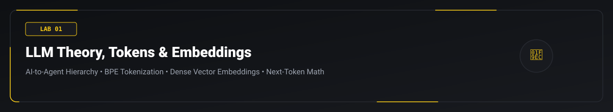
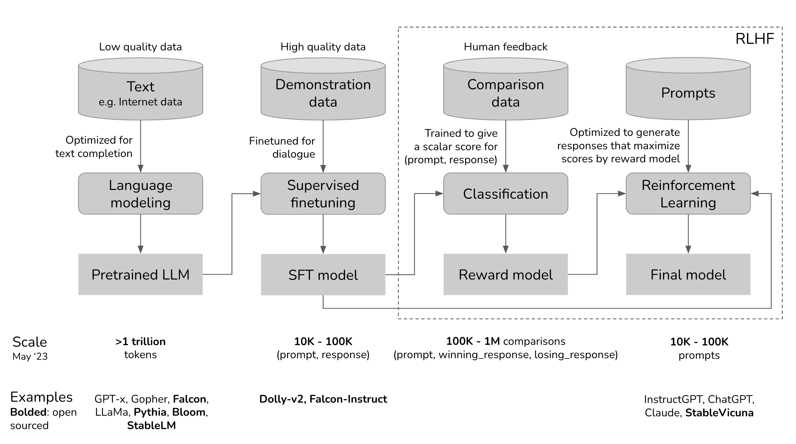
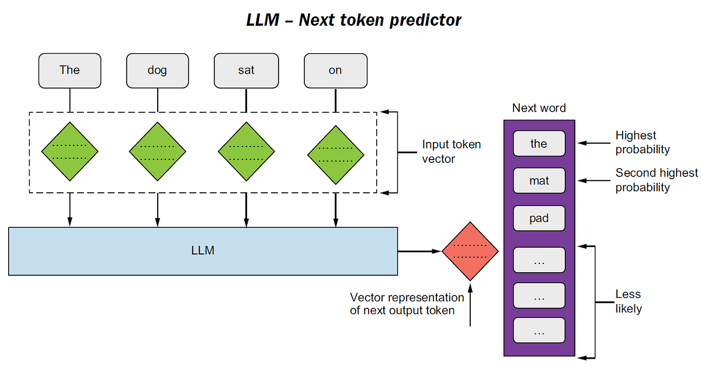
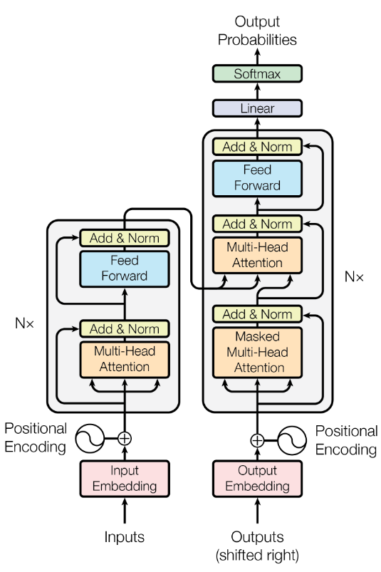

> **Explore how neural networks transform words into token vectors, calculate semantic similarity, and predict the next token probabilistic distribution.**

Welcome to Lab 01! In this chapter, we unpack the mathematical and conceptual foundations that power modern Large Language Models (LLMs). Rather than treating models as mysterious black boxes, you will inspect how words are chopped into sub-word tokens, how those tokens are projected into multi-dimensional geometric embedding vectors, and why modern LLMs are fundamentally autoregressive next-token prediction engines.

> ⚠️ **Prerequisites**: Make sure you've completed **[Lab 00: Setup & CPU Tuning](lab-00-setup-and-cpu-tuning.md)** first. You'll need Ollama running with `qwen2.5:1.5b` pulled and dependencies installed via `pip install -r requirements.txt`.

## 🎯 Learning Objectives

By the end of this lab, you'll be able to:

- Map the evolutionary hierarchy from classical AI and Machine Learning to Agentic AI
- Understand the three-stage training pipeline: Pre-Training, Supervised Fine-Tuning (SFT), and RLHF
- Explain Byte-Pair Encoding (BPE) sub-word tokenization mechanics
- Calculate semantic similarity between text prompts using vector embeddings and cosine math
- Inspect probabilistic token distributions using Ollama's `/api/embed` and `/api/generate` endpoints

> ⏱️ **Estimated Time**: ~45 minutes (15 min reading + 30 min hands-on)

---

# Real-World Analogy: The Global Map of Meanings

Imagine every word or concept in human language as a location on a giant multi-dimensional globe:

- In ordinary dictionaries, words are arranged alphabetically — meaning `"apple"` is right next to `"apology"`, even though their meanings have nothing to do with each other.
- In **Vector Embedding Space**, words are mapped according to **meaning and context**. `"Apple"` is situated right next to `"pear"`, `"orange"`, and `"banana"`. In another cluster, `"cybersecurity"`, `"firewall"`, and `"vulnerability"` sit within walking distance of each other.
- When an LLM "reads" your prompt, it translates your words into coordinates in this geometric space, allowing it to navigate relationships, synonyms, and logical connections mathematically.

<p align="center">
  
</p>

---

## The AI Hierarchy: From Algorithms to Autonomous Agents

To understand where LLMs and Agents fit into modern computer science, look at the nested hierarchy of artificial intelligence:

```
  ┌─────────────────────────────────────────────────────────────────┐
  │ 1. Artificial Intelligence (AI)                                 │
  │    Rule-based systems, expert systems, search trees (A*, minimax)│
  │  ┌───────────────────────────────────────────────────────────┐  │
  │  │ 2. Machine Learning (ML)                                  │  │
  │  │    Algorithms learning from statistical data (Linear, SVM)│  │
  │  │  ┌─────────────────────────────────────────────────────┐  │  │
  │  │  │ 3. Deep Learning (DL)                               │  │  │
  │  │  │    Multi-layer artificial neural networks (CNN, RNN)│  │  │
  │  │  │  ┌───────────────────────────────────────────────┐  │  │  │
  │  │  │  │ 4. Generative AI (GenAI)                      │  │  │  │
  │  │  │  │    Models generating novel text, audio, images│  │  │  │
  │  │  │  │  ┌─────────────────────────────────────────┐  │  │  │  │
  │  │  │  │  │ 5. Large Language Models (LLMs)         │  │  │  │  │
  │  │  │  │  │    Autoregressive transformer predictors│  │  │  │  │
  │  │  │  │  │  ┌───────────────────────────────────┐  │  │  │  │  │
  │  │  │  │  │  │ 6. Agentic AI (Labs 04 & 05)      │  │  │  │  │  │
  │  │  │  │  │  │    LLMs with tools, memory & loops│  │  │  │  │  │
  │  │  │  │  │  └───────────────────────────────────┘  │  │  │  │  │
  │  │  │  │  └─────────────────────────────────────────┘  │  │  │  │
  │  │  │  └───────────────────────────────────────────────┘  │  │  │
  │  │  └─────────────────────────────────────────────────────┘  │  │
  │  └───────────────────────────────────────────────────────────┘  │
  └─────────────────────────────────────────────────────────────────┘
```

---

## How Models Are Built: The 3 Training Stages

Raw base models don't automatically know how to answer questions politely or execute tools. They are trained in three distinct stages:

<p align="center">
  
</p>

1. **Self-Supervised Pre-Training (The Foundation)**:
   The model ingests trillions of tokens from public text, code, and books. It learns grammar, factual knowledge, and reasoning patterns purely by guessing masked or missing next tokens. Result: A **Base Model** (e.g. `qwen2.5-base`).
2. **Supervised Fine-Tuning (SFT / Instruction Tuning)**:
   Curated high-quality question-and-answer pairs teach the model the conversational structure: `"User: What is a firewall? Assistant: A firewall is..."`. Result: An **Instruct Model** (e.g. `qwen2.5:1.5b-instruct`).
3. **Reinforcement Learning from Human Feedback (RLHF / DPO)**:
   Human evaluators (or AI judges) rank multiple model completions. The model is penalized for toxic, harmful, or hallucinated outputs and rewarded for helpful, accurate, concise answers.

---

## Tokenization: Sub-Words, Not Letters

Computers do not read letters or ASCII strings directly. An LLM's first layer is a **Byte-Pair Encoding (BPE)** tokenizer:

<p align="center">
  
</p>

- Common words become a single token: `"security"` → `[4281]`
- Rare or compound words are broken into sub-words: `"unauthenticated"` → `["un", "authent", "icated"]`
- Whitespace and punctuation get their own token IDs: `" Hello"` is different from `"Hello"`

Once tokenized, the sequence of integer IDs is passed into the **Transformer Multi-Head Attention** architecture:

<p align="center">
  
</p>

> 🌐 **Interactive Visualizer**: Check out [Transformer Explainer](https://poloclub.github.io/transformer-explainer/) to see self-attention matrices calculate token weights in real time inside your browser!

---

## See It In Action

### Demo 1: Inspecting Vector Embeddings with Python

Let's call Ollama's `/api/embed` endpoint directly using Python to see how our primary model projects text into geometric vectors:

```python
import requests

response = requests.post(
    "http://localhost:11434/api/embed",
    json={"model": "qwen2.5:1.5b", "input": "cybersecurity vulnerability"}
)

data = response.json()
embeddings = data["embeddings"][0]

print(f"Vector Dimensions: {len(embeddings)}")
print(f"First 5 coordinates: {embeddings[:5]}")
```

<details>
<summary>🎬 See it in action!</summary>

```text
Vector Dimensions: 1536
First 5 coordinates: [-0.0142, 0.0821, -0.0415, 0.0093, 0.0617]
```
</details>

**The takeaway**: Every concept is compressed into an exact list of 1,536 floating-point numbers. Two concepts that share meaning point in nearly the same mathematical direction!

---

### Demo 2: Calculating Cosine Similarity

To measure how semantically related two phrases are, we compute the **Cosine Similarity** of their embedding vectors:

$$\text{similarity}(\vec{A}, \vec{B}) = \frac{\vec{A} \cdot \vec{B}}{\|\vec{A}\| \|\vec{B}\|} = \frac{\sum A_i B_i}{\sqrt{\sum A_i^2} \sqrt{\sum B_i^2}}$$

A score of `1.0` means identical meaning; `0.0` means completely orthogonal / unrelated.

Let's test three phrases:
1. `"cybersecurity vulnerability scan"`
2. `"security audit log review"`
3. `"pizza recipe with extra cheese"`

---

## 📝 Assignment

### Main Challenge: Complete `exercises/ex01_token_explorer.py`

Open `exercises/ex01_token_explorer.py` in your code editor and implement the five `# TODO` markers:

1. **TODO 1**: Call `/api/embed` with your selected model.
2. **TODO 2**: Implement pure-Python `cosine_similarity(vec_a, vec_b)` without importing numpy.
3. **TODO 3**: Extract and inspect the dimension length and L2 norm ($\sqrt{\sum x^2}$).
4. **TODO 4**: Compute pairwise similarity between related security terms vs. unrelated pizza terms.
5. **TODO 5**: Render results using Rich terminal tables.

Run your script:

```powershell
python exercises/ex01_token_explorer.py
```

**Success criteria**: Your terminal displays a cleanly formatted Rich table showing that Phrase 1 and Phrase 2 share high similarity (> 0.70), while Phrase 1 and Phrase 3 show low similarity (< 0.25).

<details>
<summary>💡 Hints (click to expand)</summary>

- The dot product can be calculated in one line: `sum(a * b for a, b in zip(vec_a, vec_b))`.
- The magnitude is `sum(x**2 for x in vec)**0.5`.
- Avoid division by zero by ensuring magnitudes are greater than `1e-9`.
- Compare your implementation against the complete reference solution in `solutions/sol01_token_explorer.py`.
</details>

### Bonus Challenge: Explore Next-Token Logprobs

Run `solutions/sol01_token_explorer.py` and inspect how the model calculates probability distributions over the vocabulary for a prompt like `"The capital of France is"`:

```powershell
python solutions/sol01_token_explorer.py
```

Observe how `" Paris"` receives > 95% of the probability mass, while other candidates receive tiny fractions of a percent.

---

<details>
<summary>🔧 <strong>Common Mistakes & Troubleshooting</strong> (click to expand)</summary>

### Common Mistakes

| Mistake | What Happens | Fix |
|---|---|---|
| Calculating cosine similarity on vectors of different lengths | `zip` truncates or raises error | Always ensure both vectors come from the exact same model embedding endpoint |
| Forgetting to strip whitespace before calculating similarity | Leading spaces alter token IDs | Normalize input strings with `.strip()` before embedding |
| Calling `/api/embeddings` (deprecated) instead of `/api/embed` | HTTP 404 Not Found | Modern Ollama versions use `/api/embed` |

### Troubleshooting

- **"ConnectionError: HTTPConnectionPool"**: Ollama is not running. Launch it with `ollama serve`.
- **"Model not found"**: Run `ollama pull qwen2.5:1.5b` to download the model.

</details>

---

# Summary

## 🔑 Key Takeaways

1. **Tokens are sub-words**: Tokenizers decompose words into numerical vocabulary IDs, reducing vocabulary size while supporting arbitrary words.
2. **Embeddings are geometric meanings**: In 1536-dimensional space, cosine angles reflect semantic relationships.
3. **LLMs are next-token predictors**: Every generation is a sequence of conditional probability samplings: $P(w_t \mid w_1, \ldots, w_{t-1})$.

> 📚 **Continued Learning**: Read Microsoft Learn's [Fundamentals of Generative AI](https://learn.microsoft.com/en-us/training/modules/fundamentals-generative-ai/?wt.mc_id=studentamb_296178) module.

---

## ➡️ What's Next

Now that you understand tokens and embeddings, what actually happens inside the computer from the moment you hit Enter until the final token is generated?

In **[Lab 02: Prompt-to-Answer Pipeline & KV Cache](lab-02-prompt-to-answer-pipeline.md)**, you'll learn:

- The critical difference between Phase 1 Prefill (parallel matmul) and Phase 2 Decode (memory-bandwidth-bound)
- How the Key-Value (KV) Cache eliminates quadratic recalculation
- Hands-on cold vs. warm cache benchmarking with `exercises/ex02_prefill_decode_benchmark.py`

---

**[⬅️ Back to Course Home](../README.md)** | **[Continue to Lab 02 ➡️](lab-02-prompt-to-answer-pipeline.md)**
