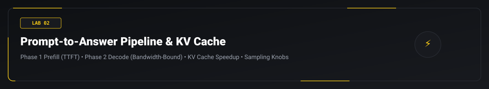
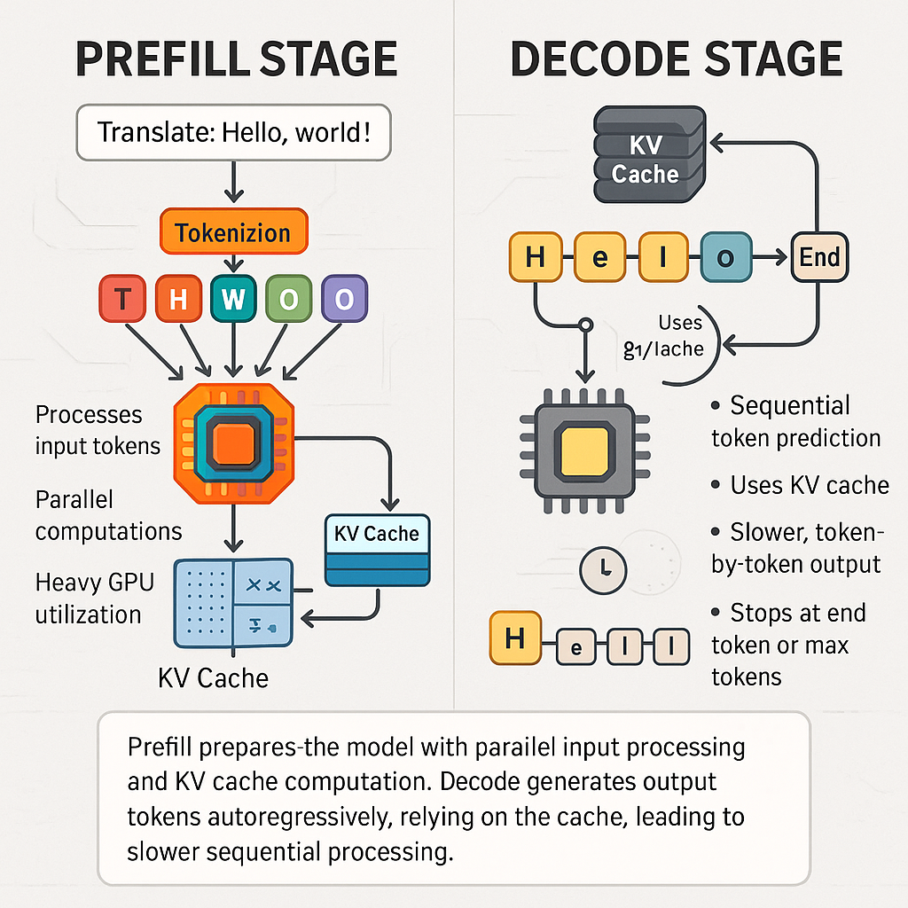

> **Inside inference: Benchmark Phase 1 Prefill (parallel matmul) vs. Phase 2 Decode (memory-bound) and measure real KV Cache acceleration on your CPU.**

Welcome to Lab 02! Have you ever wondered why your terminal pauses momentarily right after hitting Enter before the first word appears, and then streams the rest of the answer steadily token-by-token? In this lab, we look inside the inference lifecycle of a prompt. You'll measure Time-to-First-Token (TTFT), understand why the Key-Value (KV) Cache is essential for conversational AI, and experiment with sampling parameters (`temperature`, `top_k`, `top_p`).

> ⚠️ **Prerequisites**: Make sure you have completed **[Lab 01: LLM Theory, Tokens & Embeddings](lab-01-llm-theory-and-tokens.md)**. Ensure both `qwen2.5:1.5b` and `llama3.2:1b` are pulled in Ollama.

## 🎯 Learning Objectives

By the end of this lab, you'll be able to:

- Dissect the two distinct computational phases of inference: Prefill vs. Decode
- Explain why Prefill is compute-bound while Decode is memory-bandwidth-bound on CPU
- Measure Time-to-First-Token (`prompt_eval_duration`) and generation throughput (`eval_duration`)
- Quantify the speedup of a warm Key-Value (KV) Cache on multi-turn conversations
- Control generation creativity and determinism using `temperature`, `top_k`, and `top_p`

> ⏱️ **Estimated Time**: ~45 minutes (15 min reading + 30 min hands-on)

---

# Real-World Analogy: Reading the Case File vs. Dictating the Verdict

Think of an LLM as a judge presiding over a legal trial:

- **Phase 1: Prefill (Reading the Case File)**: When you hand the judge a 10-page document (your prompt), the judge can read and cross-reference all 10 pages at once. The judge highlights key passages and takes shorthand notes. This is **compute-intensive** (parallel matrix multiplication), and until the judge finishes reading, no words can be spoken. The time taken to read is your **Time-to-First-Token (TTFT)**.
- **The KV Cache (The Shorthand Notes)**: The judge keeps those summary notes on their desk.
- **Phase 2: Decode (Dictating the Verdict)**: The judge now speaks the verdict one word at a time. Each new word spoken depends on what was said before it, so the judge glances at their shorthand notes (KV Cache) rather than re-reading the entire 10-page file from scratch!

<p align="center">
  
</p>

---

## The Complete Prompt-to-Answer Pipeline

Here is the exact journey your prompt takes through the neural network:

<p align="center">
  
</p>

```
  ┌────────────────────────────────────────────────────────────────────────┐
  │ 1. User Prompt (Raw String)                                            │
  │    "Explain what a firewall does in 3 sentences."                      │
  │      │                                                                 │
  │      ▼                                                                 │
  │ 2. BPE Tokenizer -> [1542, 1102, 264, 18921, ...]                      │
  │      │                                                                 │
  │      ▼                                                                 │
  │ 3. Phase 1: Prefill (Compute-Bound / Parallel Matrix Multiplication)   │
  │    All prompt tokens evaluated simultaneously.                         │
  │    Key (K) and Value (V) tensors calculated and saved to KV Cache.     │
  │    Metric: prompt_eval_duration (Time-to-First-Token)                  │
  │      │                                                                 │
  │      ▼                                                                 │
  │ 4. Phase 2: Autoregressive Decode (Memory-Bandwidth-Bound / Sequential)│
  │    Token 1 generated -> Appended to KV Cache                           │
  │    Token 2 generated -> Appended to KV Cache                           │
  │    Metric: eval_duration / eval_count (Tokens Per Second)              │
  │      │                                                                 │
  │      ▼                                                                 │
  │ 5. Sampling Knobs (Logits -> Token Selection)                          │
  │    Temperature, Top-K, Top-P filter candidate probabilities.           │
  │      │                                                                 │
  │      ▼                                                                 │
  │ 6. Detokenizer -> "A firewall is a network security device that..."    │
  └────────────────────────────────────────────────────────────────────────┘
```

---

## Sampling Knobs: Controlling Generation

Once the model computes logits (raw prediction scores) across its 150,000+ vocabulary tokens, the final token is selected using three critical parameters:

| Parameter | Default | Range | Impact on Generation |
|---|:---:|:---:|---|
| **`temperature`** | `0.7` | `0.0 - 2.0` | Controls randomness. `0.0` is completely greedy / deterministic (always picks the highest probability token). Higher values flatten the distribution, increasing creativity. |
| **`top_k`** | `40` | `1 - 100` | Hard cutoff. Restricts candidate selection to only the top $K$ most probable tokens, discarding the long tail of low-probability words. |
| **`top_p`** | `0.9` | `0.0 - 1.0` | Nucleus sampling. Accumulates tokens until their cumulative probability exceeds $P$. Dynamically narrows vocabulary when confidence is high. |
| **`num_ctx`** | `2048` | `512 - 32768` | Size of the context window buffer allocated in RAM for the KV Cache. |

---

## See It In Action

### Demo 1: Inspecting Raw Timing Metadata from Ollama

When you send a request to Ollama's `/api/generate` with `stream=False`, Ollama returns nanosecond-precision timing data in the response JSON:

```python
import requests

payload = {
    "model": "qwen2.5:1.5b",
    "prompt": "What is an IP address?",
    "stream": False
}

res = requests.post("http://localhost:11434/api/generate", json=payload).json()

# Nanoseconds to seconds conversion (1e9)
ttft_sec = res["prompt_eval_duration"] / 1e9
decode_sec = res["eval_duration"] / 1e9
tokens_per_sec = res["eval_count"] / decode_sec

print(f"Time-to-First-Token (Prefill): {ttft_sec:.3f} s")
print(f"Generation Speed (Decode):     {tokens_per_sec:.1f} tokens/sec")
print(f"Total Output Tokens:           {res['eval_count']} tokens")
```

<details>
<summary>🎬 See it in action!</summary>

```text
Time-to-First-Token (Prefill): 0.182 s
Generation Speed (Decode):     31.4 tokens/sec
Total Output Tokens:           68 tokens
```
</details>

**The takeaway**: Ollama automatically profiles every inference request. `prompt_eval_duration` measures the initial reading speed (Prefill), while `eval_duration` measures writing throughput (Decode).

---

### Demo 2: Measuring Cold vs. Warm KV Cache Speedup

What happens when you send the exact same long prompt twice in a row?

1. **Run 1 (Cold Cache)**: Ollama must read the entire prompt, calculate $K$ and $V$ tensors for every token, and allocate memory.
2. **Run 2 (Warm Cache)**: Ollama identifies that the prompt tokens match existing entries in the KV Cache and reuses them instantly!

---

## 📝 Assignment

### Main Challenge: Benchmark Prefill & Decode with `ex02_prefill_decode_benchmark.py`

Open `exercises/ex02_prefill_decode_benchmark.py` and implement the `# TODO` markers:

1. **TODO 1**: Build `run_inference(model, prompt, options)` sending parameters to `/api/generate`.
2. **TODO 2**: Execute Run 1 (cold) and Run 2 (warm) with an identical security prompt.
3. **TODO 3**: Calculate the Speedup Ratio: $\frac{\text{Cold TTFT}}{\text{Warm TTFT}}$.
4. **TODO 4**: Perform a temperature sweep (`[0.0, 0.5, 1.0]`) and observe output variability.
5. **TODO 5**: Compare `qwen2.5:1.5b` vs. `llama3.2:1b` throughput side-by-side.

Run your benchmark:

```powershell
python exercises/ex02_prefill_decode_benchmark.py
```

**Success criteria**: Your terminal renders a Rich benchmark table showing that Run 2 achieves a significant TTFT speedup (often 2x–5x faster) thanks to KV Cache reuse.

<details>
<summary>💡 Hints (click to expand)</summary>

- To ensure the model remains resident in memory between runs, keep `OLLAMA_KEEP_ALIVE=5m`.
- Notice how `temperature=0.0` produces the exact same words on every repeat execution.
- Notice how `llama3.2:1b` achieves even higher token generation speeds (> 45 tokens/sec) due to its smaller parameter footprint.
- Check `solutions/sol02_prefill_decode_benchmark.py` to compare your implementation.
</details>

### Bonus Challenge: Experiment with Context Window Size (`num_ctx`)

Modify the `options` dictionary in your call to test `num_ctx: 1024` vs `num_ctx: 8192`:
- Does increasing `num_ctx` increase the initial RAM allocation?
- Check task manager while the test is running!

---

<details>
<summary>🔧 <strong>Common Mistakes & Troubleshooting</strong> (click to expand)</summary>

### Common Mistakes

| Mistake | What Happens | Fix |
|---|---|---|
| Setting `temperature: 0` for creative tasks | Output becomes robotic, repetitive, and stiff | Use `temperature: 0.7` for creative writing, `0.0 - 0.2` for JSON & code |
| Measuring TTFT with `stream: True` using total clock time | Confuses network streaming with model evaluation | Always use the server-reported `prompt_eval_duration` for accurate TTFT |
| Running benchmarks while heavy background apps use CPU | Inconsistent latency spikes | Close video rendering or gaming apps while benchmarking CPU inference |

### Troubleshooting

- **"High TTFT on first run (> 5s)"**: This includes initial weight loading from SSD to RAM. The second run reflects genuine warm KV cache inference.
- **"Out of memory during inference"**: Reduce `num_ctx` in options (e.g. `num_ctx: 2048`).

</details>

---

# Summary

## 🔑 Key Takeaways

1. **Prefill is parallel (Compute-Bound)**: All prompt tokens are evaluated in parallel to initialize the Key-Value (KV) Cache.
2. **Decode is serial (Memory-Bandwidth-Bound)**: New tokens are generated one-by-one; CPU memory bus speed is the primary performance bottleneck.
3. **The KV Cache prevents $O(N^2)$ recalculation**: By storing computed key and value tensors, multi-turn chat sessions remain fast and responsive.

---

## ➡️ What's Next

Now that you've mastered prompt mechanics and inference parameters, let's learn how to package custom local assistants and enforce strict JSON schemas!

In **[Lab 03: Ollama CLI & Custom Modelfiles](lab-03-ollama-cli-and-modelfile.md)**, you'll learn:

- How to inspect and manage models using the Ollama CLI
- How to write a custom `Modelfile` packaging system prompts and sampling parameters
- How to enforce deterministic JSON output schemas using Pydantic
- Hands-on client implementation with `exercises/ex03_custom_modelfile_client.py`

---

**[⬅️ Back to Course Home](../README.md)** | **[Continue to Lab 03 ➡️](lab-03-ollama-cli-and-modelfile.md)**
