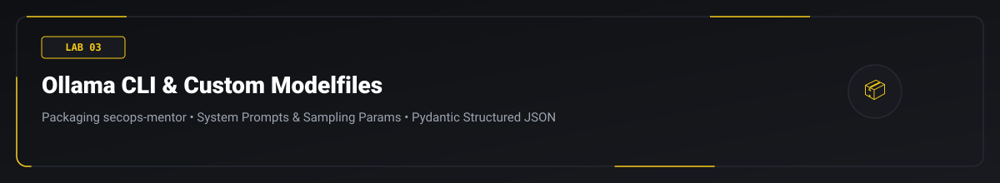
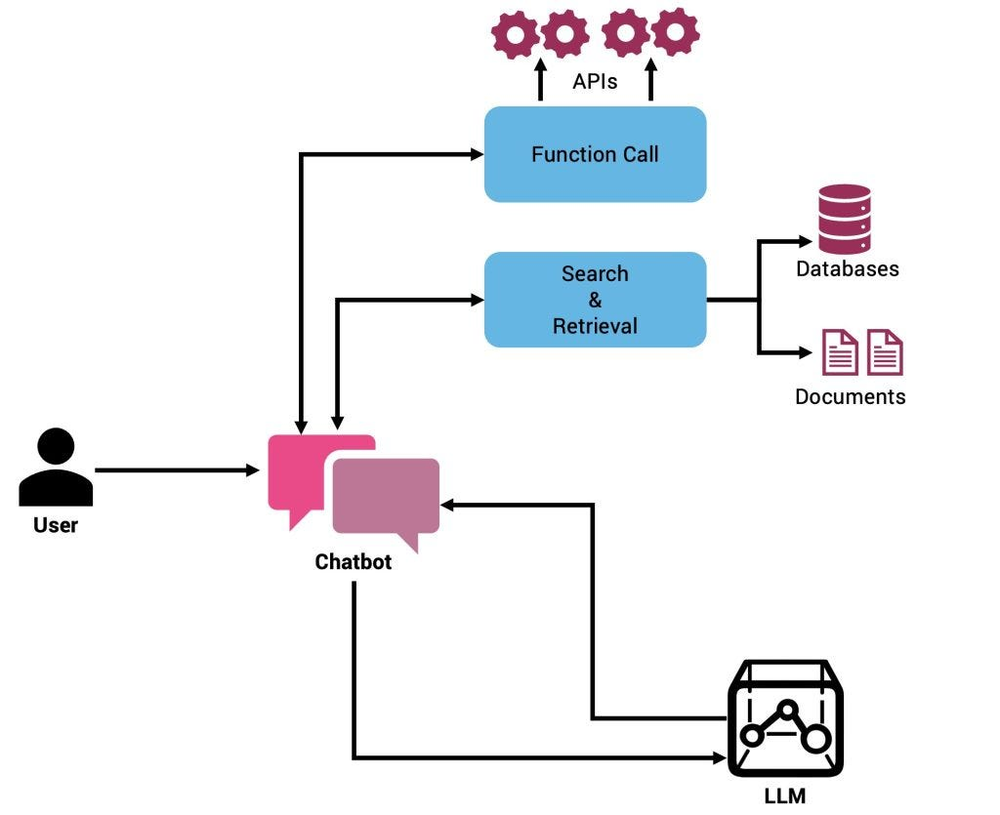

> **Build custom local AI assistants using Ollama Modelfiles and enforce 100% deterministic, structured JSON schemas with Pydantic validation.**

Welcome to Lab 03! When building production applications and agents, raw free-text completions are dangerous. If an LLM returns unexpected conversational chatter, your downstream software will crash with JSON parsing errors. In this lab, you will master the Ollama CLI, package a custom DevSecOps assistant (`secops-mentor`) using an Ollama `Modelfile`, and enforce rigid structured JSON outputs using Pydantic validation.

> ⚠️ **Prerequisites**: Make sure you've completed **[Lab 02: Prompt-to-Answer Pipeline & KV Cache](lab-02-prompt-to-answer-pipeline.md)**. Ensure `pydantic>=2.5.0` is installed (`pip install -r requirements.txt`).

## 🎯 Learning Objectives

By the end of this lab, you'll be able to:

- Master advanced Ollama CLI commands (`ollama show --modelfile`, `ollama ps`, `ollama cp`)
- Understand the quantization spectrum: from FP16 unquantized to GGUF `Q4_K_M` and `Q2_K`
- Author and build a custom model container using the `Modelfile` syntax
- Enforce strict JSON output using Ollama's `format="json"` API parameter
- Validate model outputs against strongly-typed Pydantic data schemas

> ⏱️ **Estimated Time**: ~40 minutes (15 min reading + 25 min hands-on)

---

# Real-World Analogy: The Docker Container for AI Weights

Think of a standard foundation model like an unconfigured Linux ISO image:

- A raw model (`qwen2.5:1.5b`) is capable of doing anything, but has no specific role, default temperature, or boundary instructions.
- An **Ollama Modelfile** is like a **Dockerfile**. It packages the base operating system (`FROM qwen2.5:1.5b`), configures the environment settings (`PARAMETER temperature 0.2`, `PARAMETER num_ctx 4096`), and injects custom startup commands and specialized persona instructions (`SYSTEM """You are SecOps Mentor..."""`).
- Running `ollama create secops-mentor -f Modelfile` builds a new, immutable AI image that you can deploy, version, and share with your entire team!

<p align="center">
  
</p>

---

## Ollama CLI Command Reference

The Ollama CLI provides complete lifecycle management for local models:

| Command | Usage | Description |
|---|---|---|
| `ollama list` | `ollama list` | List all models installed locally with their disk sizes and modification dates |
| `ollama ps` | `ollama ps` | Display active models currently occupying RAM, processor allocation (CPU/GPU), and time remaining |
| `ollama show --modelfile <model>` | `ollama show --modelfile qwen2.5:1.5b` | Inspect the underlying Modelfile, system prompt, and parameters of any installed model |
| `ollama create <name> -f <file>` | `ollama create secops-mentor -f Modelfile` | Build and register a custom model from a local Modelfile |
| `ollama cp <src> <dest>` | `ollama cp qwen2.5:1.5b backup-model` | Create a fast local alias or backup copy of a model without re-downloading |
| `ollama rm <model>` | `ollama rm backup-model` | Remove an unused model to immediately free disk space |

---

## Understanding Quantization Levels (GGUF)

When models are published by research labs, weights are stored as 16-bit floating-point numbers (`FP16`). Quantization groups and rounds these numbers into smaller bit representations:

| Quantization Format | Bits per Weight | Memory Required (1.5B) | Quality Retention | Recommendation |
|:---:|:---:|:---:|:---:|---|
| **`FP16`** | 16.0 | ~3.4 GB | 100.0% | Heavy for laptops; requires GPU |
| **`Q8_0`** | 8.5 | ~1.8 GB | 99.8% | High precision; good if you have 16 GB+ RAM |
| **`Q4_K_M`** ⭐ | **4.5** | **~1.0 GB** | **99.2%** | **The Gold Standard: Perfect CPU balance of speed & quality** |
| **`Q2_K`** | 2.6 | ~0.6 GB | 88.5% | Extreme compression; noticeable degradation |

Ollama's default library tags (such as `qwen2.5:1.5b` and `llama3.2:1b`) are pre-quantized using `Q4_K_M`.

---

## Anatomy of a Production Modelfile

Examine the `Modelfile` located at the root of this repository:

```dockerfile
# 1. Base Image
FROM qwen2.5:1.5b

# 2. Model Parameters (Sampling Knobs)
PARAMETER temperature 0.2
PARAMETER top_p 0.9
PARAMETER top_k 40
PARAMETER num_ctx 4096
PARAMETER repeat_penalty 1.1
PARAMETER stop "<|im_end|>"

# 3. System Persona & Output Contract
SYSTEM """
You are SecOps Mentor — a precise, structured AI assistant for cybersecurity operations and DevSecOps workflows.
Always respond with valid JSON when instructed. Never hallucinate tool names or file paths.
Keep answers concise and actionable. When uncertain, state it explicitly rather than guessing.
For threat analysis tasks, structure output as: {"severity": "...", "findings": [...], "remediation": [...]}.
"""
```

---

## See It In Action

### Demo 1: Creating Your Custom Model

Build the custom `secops-mentor` assistant using the Ollama CLI:

```powershell
# From the repository root:
ollama create secops-mentor -f Modelfile
```

<details>
<summary>🎬 See it in action!</summary>

```text
transferring system prompt
reading model metadata
creating new layer sha256:72e25b0...
writing manifest
success
```
</details>

Verify that your new model appears in the local registry:

```powershell
ollama list
```

**The takeaway**: In less than 3 seconds, you created a specialized local AI model without re-downloading any weights!

---

### Demo 2: Structured Pydantic JSON Validation

In Python, we define our desired data schema using **Pydantic**:

```python
from pydantic import BaseModel
from typing import List

class ThreatReport(BaseModel):
    severity: str          # "critical", "high", "medium", "low"
    cve: str               # "CVE-XXXX-XXXX" or "N/A"
    description: str       # Brief threat summary
    remediation: List[str] # Specific actionable steps
    affected_systems: List[str]
```

When we query Ollama with `format="json"`, the model is constrained to generate valid JSON matching our schema:

```python
import requests
import json

prompt = "Analyze Log4Shell vulnerability and provide remediation steps."

response = requests.post(
    "http://localhost:11434/api/chat",
    json={
        "model": "secops-mentor",
        "messages": [{"role": "user", "content": prompt}],
        "format": "json",
        "stream": False
    }
)

raw_json = json.loads(response.json()["message"]["content"])
report = ThreatReport.model_validate(raw_json)

print(f"Severity:    {report.severity.upper()}")
print(f"CVE ID:      {report.cve}")
print(f"Action Item: {report.remediation[0]}")
```

---

## 📝 Assignment

### Main Challenge: Complete `exercises/ex03_custom_modelfile_client.py`

Open `exercises/ex03_custom_modelfile_client.py` and implement the `# TODO` markers:

1. **TODO 1**: Complete the `ThreatReport` Pydantic class by adding `remediation` and `affected_systems` lists.
2. **TODO 2**: Implement `check_model_exists(model_name)` querying `/api/tags`.
3. **TODO 3**: Implement `query_model()` with `format="json"` to enforce structured JSON output.
4. **TODO 4**: Handle JSON parsing and Pydantic validation with `try/except` error recovery.
5. **TODO 5**: Format the output report using Rich panels with color-coded severity badges.

Run your client script:

```powershell
python exercises/ex03_custom_modelfile_client.py
```

**Success criteria**: The script validates two complex security threats, parses them into typed `ThreatReport` objects, and renders Rich visual panels with zero runtime validation exceptions.

<details>
<summary>💡 Hints (click to expand)</summary>

- If `secops-mentor` has not been created yet, run `ollama create secops-mentor -f Modelfile` first.
- The script automatically falls back to `qwen2.5:1.5b` with an explicit system prompt if `secops-mentor` is not found.
- Use `ThreatReport.model_dump()` to convert validated Pydantic objects back into clean Python dictionaries.
- Compare with `solutions/sol03_custom_modelfile_client.py`.
</details>

### Bonus Challenge: Add Custom Tool Rules to Modelfile

Edit `Modelfile` and add a new instruction under `SYSTEM`:
```dockerfile
Always include an 'exploitability_score' between 0.0 and 10.0 in threat outputs.
```
Re-run `ollama create secops-mentor -f Modelfile` and observe how the model output adapts immediately.

---

<details>
<summary>🔧 <strong>Common Mistakes & Troubleshooting</strong> (click to expand)</summary>

### Common Mistakes

| Mistake | What Happens | Fix |
|---|---|---|
| Omitting `format="json"` in `/api/chat` requests | Model wraps JSON inside markdown fences (` ```json `), breaking strict parsers | Always pass `"format": "json"` in request payloads |
| Using high temperatures (`> 0.8`) with structured schemas | Hallucinated schema keys or invalid JSON commas | Set `temperature: 0.2` in Modelfile for predictable JSON structures |
| Forgetting to re-run `ollama create` after editing `Modelfile` | Changes do not take effect | Always re-run `ollama create <name> -f Modelfile` after edits |

### Troubleshooting

- **"ValidationError: 1 validation error for ThreatReport"**: The model omitted a required field. Add explicit examples to your Modelfile `SYSTEM` prompt.
- **"Failed to parse JSON"**: Strip any accidental leading or trailing markdown fences with `text.strip().removeprefix("```json").removesuffix("```")`.

</details>

---

# Summary

## 🔑 Key Takeaways

1. **Modelfiles package personas & knobs**: Bundle base weights, sampling parameters (`temperature 0.2`), and system instructions into versioned AI images.
2. **`format="json"` enforces deterministic contracts**: Ollama guarantees syntactically valid JSON output when this flag is activated.
3. **Pydantic brings type safety to AI**: Validating model outputs with Pydantic ensures downstream software never crashes on malformed responses.

---

## ➡️ What's Next

Now that your model can reliably output structured JSON contracts, you are ready to cross the boundary into **Agentic AI**!

In **[Lab 04: ReAct Agent Loop From Scratch](lab-04-react-agent-from-scratch.md)**, you'll learn:

- The ReAct (Reason + Act) loop architecture: `Thought -> Action -> Observation -> Final Answer`
- How to connect local Python functions (system checks, log parsers, risk calculators) to the LLM
- How to implement multi-turn tool calling with loop protections from scratch

---

**[⬅️ Back to Course Home](../README.md)** | **[Continue to Lab 04 ➡️](lab-04-react-agent-from-scratch.md)**
