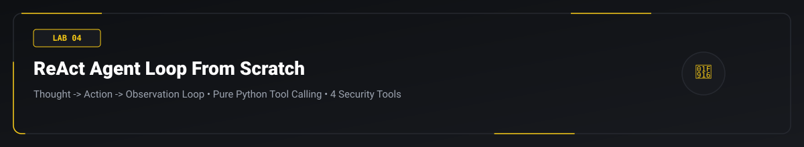
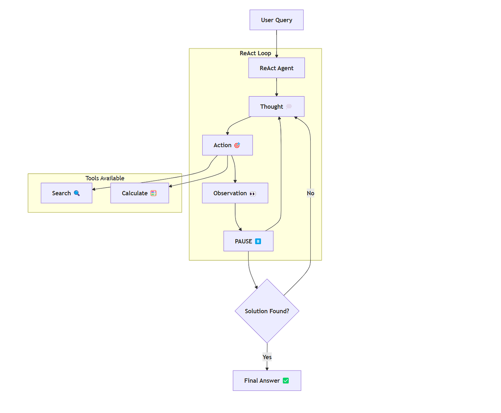
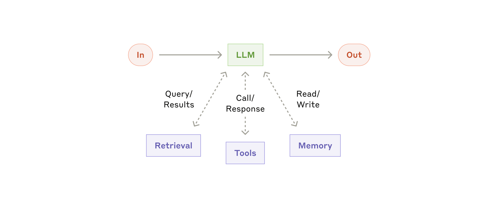

> **Cross the bridge from passive text generation to active Agentic AI: Engineer a pure-Python ReAct reasoning and tool-calling loop on localhost:11434.**

Welcome to the heart of the course! Until now, our LLM has been passive — waiting for input and returning words. But what if the model needs real-time data from your system, like CPU usage, disk space, or an internal security database? In this lab, you will build a transparent **ReAct (Reason + Act)** agent loop from scratch in pure Python. No opaque heavyweight frameworks (no LangChain, no AutoGen) — just clean, understandable code connecting an LLM to real system tools.

> ⚠️ **Prerequisites**: Make sure you've completed **[Lab 03: Ollama CLI & Custom Modelfiles](lab-03-ollama-cli-and-modelfile.md)**. Ensure `psutil` is installed (`pip install -r requirements.txt psutil`).

## 🎯 Learning Objectives

By the end of this lab, you'll be able to:

- Distinguish a passive language model from an active autonomous agent
- Master the ReAct framework: `Thought -> Action -> Observation -> Final Answer`
- Define OpenAI-compatible JSON tool schemas for local Python functions
- Build a resilient multi-turn tool-calling while-loop against `http://localhost:11434/api/chat`
- Implement loop guards (`max_iterations=5`) to prevent infinite recursion and token exhaustion

> ⏱️ **Estimated Time**: ~60 minutes (20 min reading + 40 min hands-on)

---

# Real-World Analogy: The Detective at the Crime Scene

Think of a passive LLM as an armchair consultant who has never left their office:
- If you ask: *"What is the temperature in my living room right now?"*, the consultant can only guess based on historical averages. They cannot look at a thermometer!

An **Agent**, by contrast, is a field detective equipped with tools:
1. **Thought**: *"To determine the current temperature, I need to check the living room thermostat."*
2. **Action**: The detective reaches for a specific tool: `read_thermostat(room="living_room")`.
3. **Observation**: The tool returns real sensor data: `{"temp_c": 21.5, "status": "nominal"}`.
4. **Final Answer**: The detective evaluates the reading and answers: *"The living room temperature is currently 21.5°C."*

<p align="center">
  
</p>

---

## The Augmented LLM Pattern

This paradigm, popularized by research at Google and Anthropic, augments foundation models with external execution capabilities:

<p align="center">
  
</p>

1. **Model as Reasoner**: The LLM does not perform math, execute code, or query databases directly; it decides *what tool to call* and *with what arguments*.
2. **Execution Environment**: Your local Python runtime executes the function safely.
3. **Observation Ingestion**: Tool outputs are fed back to the model as context.
4. **Convergence**: The cycle repeats until the model has sufficient data to generate a `final_answer`.

---

## The 4 Local Python Security Tools

In this lab, our ReAct agent has access to four real Python functions:

```python
# 1. Inspect live system hardware telemetry
check_host_resources() -> dict

# 2. Compute risk matrix based on severity, exploitability & asset value
calculate_risk_score(severity: str, exploitability: float, asset_value: int) -> dict

# 3. Query internal incident response runbooks
search_runbook(query: str) -> dict

# 4. Parse raw authentication and kernel log lines
inspect_log_entry(log_line: str) -> dict
```

---

## See It In Action

### Demo 1: Tool Schema Definition

Tools are exposed to the model using standard JSON Schema definitions:

```python
TOOL_SCHEMAS = [
    {
        "name": "check_host_resources",
        "description": "Get current host CPU percent, RAM usage, and available disk space.",
        "parameters": {
            "type": "object",
            "properties": {},
            "required": []
        }
    },
    {
        "name": "calculate_risk_score",
        "description": "Calculate a quantitative risk score (0.0 to 10.0) for a security event.",
        "parameters": {
            "type": "object",
            "properties": {
                "severity": {"type": "string", "enum": ["critical", "high", "medium", "low"]},
                "exploitability": {"type": "number", "description": "Score from 0.0 to 1.0"},
                "asset_value": {"type": "integer", "description": "Asset criticality rating from 1 to 10"}
            },
            "required": ["severity", "exploitability", "asset_value"]
        }
    }
]
```

---

### Demo 2: The ReAct While-Loop in Pure Python

Here is the clean core loop that drives the agent:

```python
MAX_ITERATIONS = 5

for iteration in range(MAX_ITERATIONS):
    # Step 1: Send current conversation history to Ollama
    response = call_ollama_chat(messages, format="json")
    parsed = parse_agent_json(response)
    
    # Step 2: Check if agent has reached a Final Answer
    if "final_answer" in parsed:
        print(f"Final Answer: {parsed['final_answer']}")
        break
        
    # Step 3: Check if agent wants to execute a Tool
    if "action" in parsed:
        tool_name = parsed["action"]
        tool_args = parsed.get("action_input", {})
        
        # Execute tool locally
        observation = execute_tool(tool_name, tool_args)
        
        # Append assistant decision & observation back to conversation history
        messages.append({"role": "assistant", "content": response})
        messages.append({"role": "user", "content": f"Observation: {observation}"})
```

<details>
<summary>🎬 See it in action!</summary>

```text
=== Iteration 1/5 ===
[Thought] The user wants host resource usage. I need to run check_host_resources.
[Action]  check_host_resources({})
[Observation] {"cpu_percent": 14.2, "ram_used_gb": 3.8, "disk_free_gb": 12.4}

=== Iteration 2/5 ===
[Thought] The user also asked for a risk score for an SSH brute force with exploitability 0.8 on asset 9.
[Action]  calculate_risk_score({"severity": "high", "exploitability": 0.8, "asset_value": 9})
[Observation] {"risk_score": 6.48, "rating": "HIGH"}

=== Iteration 3/5 ===
[Thought] I now have both host telemetry and the calculated risk score.
[Final Answer] The host system is healthy (CPU: 14.2%, RAM: 3.8 GB). The SSH brute force attack has a calculated risk score of 6.48 (HIGH).
```
</details>

**The takeaway**: The agent autonomously orchestrated two separate tools across multiple turns, ingested real observations, and synthesized a complete final answer!

---

## 📝 Assignment

### Main Challenge: Complete `exercises/ex04_react_agent_loop.py`

Open `exercises/ex04_react_agent_loop.py` and implement the `# TODO` markers:

1. **TODO 1**: Define JSON schema dictionaries for all 4 security tools.
2. **TODO 2**: Build the ReAct system prompt instructing the model to output either `{"thought": "...", "action": "...", "action_input": {...}}` or `{"thought": "...", "final_answer": "..."}`.
3. **TODO 3**: Implement `parse_agent_response()` to strip markdown fences and parse JSON safely.
4. **TODO 4**: Implement `execute_tool()` to dynamically dispatch calls using Python's `**kwargs`.
5. **TODO 5**: Wire the `run_react_agent()` while-loop with `MAX_ITERATIONS=5` loop protection.

Run your agent:

```powershell
python exercises/ex04_react_agent_loop.py
```

**Success criteria**: The agent resolves a multi-part query by calling at least two tools sequentially and outputting a comprehensive final answer within 3–4 iterations.

<details>
<summary>💡 Hints (click to expand)</summary>

- Wrap tool dispatch in `try/except` to catch `KeyError` (unknown tool) and feed the error string back as an observation so the model can self-correct!
- Use Rich panels to color-code thoughts (yellow), actions (cyan), and observations (gray).
- Compare your implementation with `solutions/sol04_react_agent_loop.py`.
</details>

### Bonus Challenge: Handle Tool Failures Gracefully

Test your agent with a query that targets an unknown tool:
- Observe how the model reads the error observation: `"Error: Tool 'database_query' not found"` and pivots to a different tool to solve the task!

---

<details>
<summary>🔧 <strong>Common Mistakes & Troubleshooting</strong> (click to expand)</summary>

### Common Mistakes

| Mistake | What Happens | Fix |
|---|---|---|
| Omitting `MAX_ITERATIONS` loop protection | Agent gets stuck in an infinite tool-calling loop, consuming CPU | Always enforce `for iteration in range(MAX_ITERATIONS)` |
| Not feeding observations back into the conversation history | Agent repeats the same tool call because it never saw the result | Append `{"role": "user", "content": f"Observation: {obs}"}` after every tool execution |
| Passing string arguments to tools expecting numbers | TypeErrors inside Python tool functions | Ensure tool parameters are properly cast in schema definitions |

### Troubleshooting

- **"Max iterations reached without final answer"**: The prompt may be too vague. Ensure your system prompt explicitly commands: *"When you have enough information, output a final_answer key"*.
- **"psutil not installed"**: Run `pip install psutil` in your terminal.

</details>

---

# Summary

## 🔑 Key Takeaways

1. **ReAct pairs reasoning with action**: Interleaving thoughts and tool calls dramatically reduces hallucinations.
2. **Conversation history is the agent's working memory**: The messages array preserves context across multi-step investigations.
3. **Loop guards are mandatory**: Real-world agents must have hard recursion limits (`MAX_ITERATIONS`) to prevent runaway loops.

---

## ➡️ What's Next

Now that you've built an interactive ReAct agent, how do production systems run agents automatically in the background without a human typing at the keyboard?

In **[Lab 05: Autonomous Scheduled Agent & HITL Gate](lab-05-agentic-task-scheduling.md)**, you'll learn:

- The three scheduling paradigms: Time-Driven (Cron), Event-Driven (Webhooks), and Queue-Driven
- The Model Context Protocol (MCP) standard
- Persistent state checkpointing (`agent_state.json`) and Human-in-the-Loop (HITL) approval gates

---

**[⬅️ Back to Course Home](../README.md)** | **[Continue to Lab 05 ➡️](lab-05-agentic-task-scheduling.md)**
