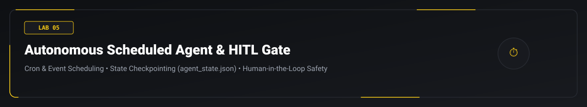
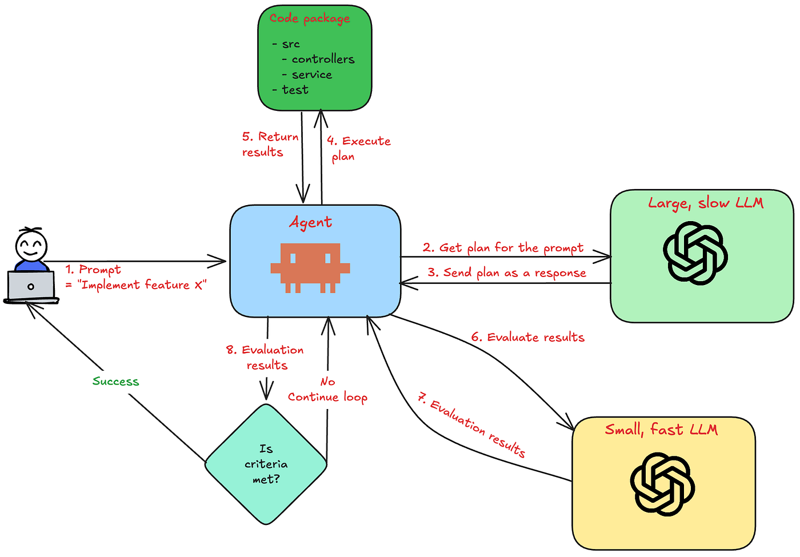
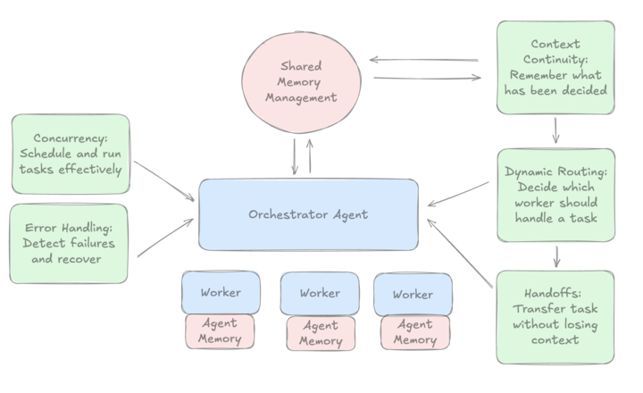

> **Build an autonomous production agent that runs on a schedule, persists state across restarts, retries with exponential backoff, and pauses at a Human-in-the-Loop approval gate.**

Welcome to the capstone lab of the **AI to Agents Session Lab**! In Lab 04, you built a ReAct agent that interacted with a user at the terminal. But in real-world production systems (such as SOC automation, infrastructure maintenance, or scheduled DevSecOps auditing), agents must run autonomously on a schedule, maintain resilient persistent state across process reboots, and safely pause before executing high-impact destructive operations. In this lab, you'll build an autonomous scheduled agent with state checkpointing and a Human-in-the-Loop (HITL) safety gate.

> ⚠️ **Prerequisites**: Make sure you've completed **[Lab 04: ReAct Agent Loop From Scratch](lab-04-react-agent-from-scratch.md)**. Ensure `schedule` is installed (`pip install -r requirements.txt`).

## 🎯 Learning Objectives

By the end of this lab, you'll be able to:

- Differentiate the three agent scheduling paradigms: Time-Driven (Cron), Event-Driven (Webhooks), and Queue-Driven
- Understand Orchestrator-Worker decomposition and the Model Context Protocol (MCP) standard
- Implement atomic persistent state checkpointing (`agent_state.json`) that survives system restarts
- Implement exponential backoff retry logic (`2^n` seconds) for resilient local inference
- Engineer an interactive Human-in-the-Loop (HITL) gate for dangerous or destructive operations

> ⏱️ **Estimated Time**: ~60 minutes (20 min reading + 40 min hands-on)

---

# Real-World Analogy: The Night Watchman with Emergency Powers

Think of an autonomous production agent like a security night watchman patrolling an office complex:

- **The Schedule (Cron)**: Every hour on the hour, the watchman starts a new patrol route.
- **The Patrol Log (`agent_state.json`)**: The watchman carries a clipboard. They record which doors were inspected, how many runs have been completed, and past anomalies. If a new watchman takes over tomorrow, the clipboard tells them the full history.
- **Routine Actions (Auto-Approved)**: Checking door locks, verifying temperatures, and inspecting badges are low-risk routine tasks executed automatically.
- **The Emergency Gate (Human-in-the-Loop)**: If the watchman discovers a gas leak and decides to cut power to the entire data center, they **do not act alone**. They pick up the phone and call the building engineer for verbal authorization!

<p align="center">
  
</p>

---

## The Three Agent Scheduling Paradigms

Production agents are activated by three fundamental architectures:

| Scheduling Paradigm | Trigger Mechanism | Real-World Use Case | Characteristics |
|---|---|---|---|
| **Time-Driven (Cron / Interval)** | Clock intervals (e.g. `every 5 minutes`) | Nightly compliance audits, hourly resource cleanup | Predictable cadence, idempotent executions |
| **Event-Driven (Webhooks / Alerts)** | HTTP webhook, pub/sub topic | SIEM incident alerts, GitHub PR pushes | Instant latency, burst capacity requirement |
| **State-Graph / Queue-Driven** | Directed Acyclic Graph (DAG), LangGraph | Multi-step bug triage across 50 repositories | Node-to-node state passing, rollback logic |

---

## Orchestrator-Worker Decomposition & MCP

As task scope expands, asking a small 1.5B model to handle planning, log triage, risk calculation, and remediation in one prompt leads to hallucinations. The **Orchestrator-Worker Pattern** solves this:

<p align="center">
  
</p>

<p align="center">
  
</p>

To connect agents to enterprise tools, Anthropic introduced the **Model Context Protocol (MCP)**:

<p align="center">
  
</p>

- **MCP Client**: Handles message routing and protocol negotiation.
- **MCP Server**: Lightweight process exposing standardized tools over `stdio` or `SSE`.
- **Universal Interoperability**: Any model (local Ollama or cloud) can query any MCP tool server without custom wrapper code.

---

## The Complete Scheduled ReAct Pipeline with HITL Gate

Here is how our complete scheduled autonomous pipeline operates:

<p align="center">
  
</p>

Notice the **Human-in-the-Loop (HITL) Gate**: When an agent proposes a high-risk action (like deleting logs or modifying firewall rules), execution pauses and prompts an operator for interactive confirmation before running the command.

---

## See It In Action

### Demo 1: Atomic State Checkpointing

State must be saved atomically so sudden power loss or process termination never corrupts `agent_state.json`:

```python
import json
from pathlib import Path

STATE_FILE = Path("agent_state.json")

def save_state_atomic(state: dict) -> None:
    temp_file = STATE_FILE.with_suffix(".tmp")
    temp_file.write_text(json.dumps(state, indent=2), encoding="utf-8")
    temp_file.replace(STATE_FILE)  # Atomic rename on NTFS and POSIX
```

---

### Demo 2: The HITL Approval Gate in Action

When a high-risk action is detected, the safety gate takes over:

```python
def hitl_gate(action_description: str, risk_level: str) -> bool:
    if risk_level.lower() in ("high", "critical"):
        print("\n⚠️  HUMAN-IN-THE-LOOP APPROVAL REQUIRED")
        print(f"Risk Rating:     {risk_level.upper()}")
        print(f"Proposed Action: {action_description}")
        
        choice = input("Authorize execution? [y/N]: ").strip().lower()
        return choice in ("y", "yes")
    return True
```

<details>
<summary>🎬 See it in action!</summary>

```text
AUDIT CYCLE #1 | 2026-11-18 16:40:00
[*] Dispatching log evaluation to local LLM with exponential backoff...
┌──────────────────┬────────────────────────────────────────────────────────┐
│ Property         │ Value                                                  │
├──────────────────┼────────────────────────────────────────────────────────┤
│ Run Count        │ 1                                                      │
│ Evaluated Events │ 4 log lines                                            │
│ LLM Summary      │ SSH brute force detected from 203.0.113.88. High risk. │
└──────────────────┴────────────────────────────────────────────────────────┘

⚠️  HUMAN-IN-THE-LOOP APPROVAL REQUIRED
Risk Rating:     HIGH
Proposed Action: Apply iptables firewall drop rule for IP 203.0.113.88.
Authorize execution? [y/N]: y
✓ Action approved by operator.
✓ State checkpoint saved to agent_state.json
```
</details>

**The takeaway**: The agent performs automated auditing autonomously, but safely yields control to a human operator before taking irreversible or destructive action.

---

## 📝 Assignment

### Main Challenge: Complete `exercises/ex05_scheduled_autonomous_agent.py`

Open `exercises/ex05_scheduled_autonomous_agent.py` and implement the `# TODO` markers:

1. **TODO 1 & 2**: Implement `load_state()` reading `agent_state.json` or returning clean defaults.
2. **TODO 3**: Implement `save_state()` writing structured state to disk.
3. **TODO 4**: Implement `query_ollama_with_retry()` with exponential backoff (`wait = 2 ** attempt`).
4. **TODO 5 & 6**: Implement `hitl_gate()` prompting for user input on high/critical actions.
5. **TODO 7–13**: Build `run_audit_job()` updating audit counters and logging findings.
6. **TODO 14 & 15**: Register the job with `schedule.every(2).minutes.do(run_audit_job)` and enter the execution loop.

Run your autonomous agent:

```powershell
python exercises/ex05_scheduled_autonomous_agent.py
```

**Success criteria**: 
- The script executes Audit Cycle #1 immediately upon launch.
- Intercepts the simulated firewall change with the interactive `[y/N]` prompt.
- Writes valid checkpoint JSON to `agent_state.json`.
- Runs recurring audits every 2 minutes without crashing.

<details>
<summary>💡 Hints (click to expand)</summary>

- Inspect `agent_state.json` in another terminal: `Get-Content agent_state.json | ConvertFrom-Json`.
- Notice how shutting down the script (Ctrl+C) and restarting it retains the previous `run_count`!
- Check `solutions/sol05_scheduled_autonomous_agent.py` for the complete reference implementation.
</details>

### Bonus Challenge: Test Crash Resilience

1. Start `solutions/sol05_scheduled_autonomous_agent.py`.
2. Let it complete Run #1 and save state.
3. Hit `Ctrl+C` to kill the process.
4. Restart the script: notice how it reads `agent_state.json` and seamlessly increments to Run #2!

---

<details>
<summary>🔧 <strong>Common Mistakes & Troubleshooting</strong> (click to expand)</summary>

### Common Mistakes

| Mistake | What Happens | Fix |
|---|---|---|
| Blocking the scheduling loop with `time.sleep(120)` | `schedule.run_pending()` misses scheduled window | Use `time.sleep(1)` inside a continuous `while True` loop |
| Forgetting encoding in state read/write | Unicode errors on non-English locales | Always specify `encoding="utf-8"` in file read/writes |
| Auto-approving critical actions without review | Destructive operations execute unchecked | Always enforce strict `risk_level in ("high", "critical")` checks |

### Troubleshooting

- **"ImportError: No module named 'schedule'"**: Run `pip install schedule`.
- **"Corrupted state file"**: Delete `agent_state.json`; the agent will automatically regenerate a clean state file on the next run.

</details>

---

# Summary

## 🔑 Key Takeaways

1. **State persistence enables resilience**: Without checkpointing to disk, scheduled agents lose all memory when restarted.
2. **Exponential backoff handles transient load**: Backing off (`1s, 2s, 4s`) keeps the agent alive during temporary CPU spikes.
3. **Human-in-the-Loop is essential for safety**: Guardrails guarantee that destructive actions are never executed without human authorization.

---

## 🎓 Course Completion & Next Steps

Congratulations! You have completed all six labs in the **AI to Agents Session Lab** curriculum:

- **Lab 00**: Zero-GPU Ollama Setup, GGUF Q4_K_M & CPU Memory Tuning
- **Lab 01**: LLM Theory, BPE Tokenization, Vector Embeddings & Next-Token Math
- **Lab 02**: Prompt-to-Answer Pipeline, Prefill vs. Decode, and KV Cache Speedup
- **Lab 03**: Ollama CLI, Custom `secops-mentor` Modelfiles & Pydantic JSON
- **Lab 04**: Pure-Python ReAct Reasoning & Tool-Calling Loop
- **Lab 05**: Autonomous Scheduled Agent with State Persistence & HITL Safety

To continue expanding your knowledge of artificial intelligence and enterprise agentic engineering, explore the official Microsoft Learn paths:

- 🌟 [Microsoft Learn: Fundamentals of Generative AI](https://learn.microsoft.com/en-us/training/modules/fundamentals-generative-ai/?wt.mc_id=studentamb_296178)
- 🌟 [Microsoft Learn: Introduction to Generative AI Path](https://learn.microsoft.com/en-us/training/paths/introduction-generative-ai/?wt.mc_id=studentamb_296178)

---

**[⬅️ Back to Course Home](../README.md)**
