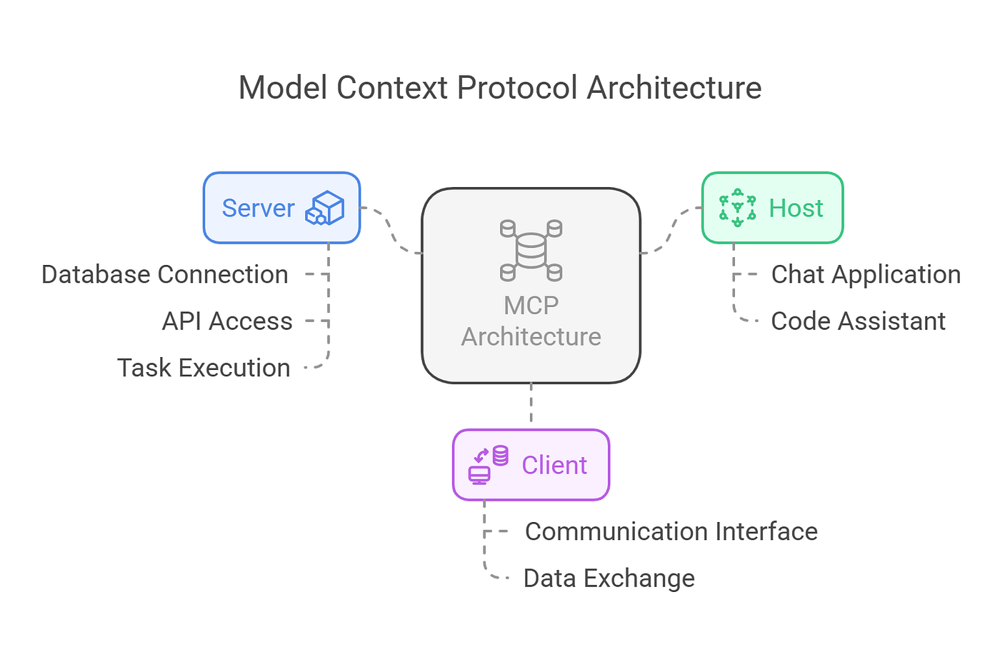

<p align="center">
  
</p>


[⬅️ Previous Lab: ReAct Agent From Scratch](lab-04-react-agent-from-scratch.md) | [🏠 Home: README](../README.md)

---

# Lab 05: Real-World Agentic Task Scheduling, Orchestrator-Workers & MCP Architecture

Welcome to the capstone lab of the **AI to Agents Session Lab**. In [Lab 04](lab-04-react-agent-from-scratch.md), you transitioned from a passive, text-in/text-out LLM to an active **ReAct Agent** executing local Python tools inside an autonomous evaluation loop.

However, in real-world production environments (such as SOC automation, autonomous infrastructure maintenance, or scheduled DevSecOps auditing), human operators do not sit at a terminal manually pressing Enter to trigger tasks. Real-world agents must operate autonomously on a schedule, ingest asynchronous external triggers, maintain resilient persistent state across process reboots, coordinate sub-agents, and safely pause at a **Human-in-the-Loop (HITL)** approval gate before executing dangerous actions.

In this lab, you will explore the architectural patterns powering autonomous agent execution and build a production-grade scheduled autonomous agent with persistent JSON checkpointing and safety guardrails.

---

## 🎯 Learning Objectives

By the end of this lab, you will be able to:
1. **Differentiate the Three Agent Scheduling Paradigms**: Time-Driven (Cron/Interval), Event-Driven (Webhooks/Alerts), and State-Graph / Queue-Driven pipelines.
2. **Understand Orchestrator-Worker & Multi-Agent Decomposition**: How complex multi-step objectives are decomposed into specialized sub-tasks assigned to worker agents.
3. **Master the Model Context Protocol (MCP)**: Understand Anthropic's open standard for connecting LLM agents to external data sources, tools, and environments.
4. **Implement State Checkpointing (`agent_state.json`)**: Ensure agent memory, audit counters, and findings survive crashes and system restarts.
5. **Implement Retry Logic with Exponential Backoff**: Handle transient Ollama inference timeouts and connection drops gracefully (`2^n` second delays).
6. **Deploy Human-in-the-Loop (HITL) Safety Gates**: Intercept high-risk destructive actions (e.g., firewall rule modification, log purge) with an interactive approval checkpoint.

---

## 📚 Theory: From Interactive Chat to Autonomous Scheduled Agents

### 1. The Autonomous Agent Lifecycle

An autonomous agent differs from a conversational chatbot through its continuous execution lifecycle:

<p align="center">
  
</p>

```
  ┌─────────────────────────────────────────────────────────────┐
  │                 Autonomous Agent Lifecycle                  │
  │                                                             │
  │   1. Trigger (Time / Webhook / Queue)                       │
  │         │                                                   │
  │         ▼                                                   │
  │   2. Load State Checkpoint (agent_state.json)               │
  │         │                                                   │
  │         ▼                                                   │
  │   3. Perception & Environment Sampling (Gather Context)     │
  │         │                                                   │
  │         ▼                                                   │
  │   4. ReAct Reasoning Loop (LLM Thought -> Tool Action)      │
  │         │                                                   │
  │         ├────► High-Risk Action? ──► [HITL Approval Gate]   │
  │         │                                                   │
  │         ▼                                                   │
  │   5. Observation Ingestion & Task Verification              │
  │         │                                                   │
  │         ▼                                                   │
  │   6. State Checkpoint Persistence (Write to disk)           │
  │         │                                                   │
  │         ▼                                                   │
  │   7. Sleep / Wait for Next Trigger Event                    │
  └─────────────────────────────────────────────────────────────┘
```

---

### 2. The Three Agent Scheduling Paradigms

Production agents are activated by three fundamental trigger architectures:

| Scheduling Paradigm | Trigger Mechanism | Real-World Use Case | Characteristics |
|---|---|---|---|
| **Time-Driven (Cron / Interval)** | Clock intervals (e.g. `every 5 minutes`, `0 2 * * *`) | Nightly compliance audits, hourly resource cleanup, log triage | Predictable cadence, idempotent executions, batch evaluation |
| **Event-Driven (Webhooks / Reactive)** | HTTP webhook, pub/sub topic, message queue | Inbound SIEM alert, GitHub push webhook, customer ticket creation | Instant latency, variable load, burst capacity requirement |
| **State-Graph / Queue-Driven** | Directed Acyclic Graph (DAG) transitions, LangGraph | Multi-step bug triage, code refactoring across 50 repositories | Node-to-node state passing, conditional branching, rollback logic |

In this lab, we build a **Time-Driven Scheduled Agent** utilizing Python's lightweight `schedule` engine running against our local `qwen2.5:1.5b` model.

---

### 3. Orchestrator-Worker Decomposition

As task complexity grows, asking a single small 1.5B or 3B model to handle planning, web browsing, data parsing, risk scoring, and report generation in one context window leads to hallucination and context overflow.

The **Orchestrator-Worker Pattern** solves this by separating high-level strategic decomposition from tactical execution:

<p align="center">
  
</p>

1. **The Orchestrator Agent**: Receives the top-level user objective (e.g., *"Perform full security audit on host 10.0.0.15"*). It breaks this down into sub-tasks and delegates them to specialized workers.
2. **Worker Agents**: Focused sub-agents with dedicated, constrained system prompts and minimal toolsets (e.g., `LogAuditorWorker`, `VulnerabilityScannerWorker`, `RemediationAdvisorWorker`).
3. **Synthesis**: The Orchestrator aggregates worker findings into a single coherent output.

<p align="center">
  
</p>

---

### 4. The Model Context Protocol (MCP)

In Lab 04, we hardcoded local Python functions into a `TOOLS` dictionary. While effective for simple scripts, this approach does not scale across enterprise environments where agents must interface with databases, GitHub repositories, Slack workspaces, and cloud APIs.

**Model Context Protocol (MCP)**, introduced by Anthropic as an open standard, creates a universal abstraction layer between AI models and tools:

<p align="center">
  
</p>

- **MCP Host**: The application environment executing the agent (e.g., Claude Desktop, IDE, or custom Python runner).
- **MCP Client**: The client library managing protocol negotiation and message routing.
- **MCP Server**: A lightweight process exposing tools, resource endpoints, and prompt templates over standard input/output (`stdio`) or Server-Sent Events (`SSE`).
- **Standardized Schema**: Tools expose their JSON schemas using standard schemas, allowing any model (local Ollama or cloud) to invoke any MCP server seamlessly.

---

### 5. Architectural Animation: Scheduled ReAct Pipeline with HITL Gate

Here is how our complete scheduled autonomous pipeline functions:

<p align="center">
  
</p>

Notice the **Human-in-the-Loop (HITL) Gate**: When an agent decides to delete files, shut down a service, or block an IP, the execution **pauses** and demands human authorization before dispatching the command.

---

## 🔬 Hands-On Step-by-Step

### Step 1: Examine the Exercise Starter File

Open `exercises/ex05_scheduled_autonomous_agent.py` in your editor. Notice the structure:
- `STATE_FILE = Path("agent_state.json")`: Path to the local state file.
- `load_state()`: Reads existing state or returns default dictionary with `run_count: 0`.
- `save_state()`: Atomic JSON writing to ensure data integrity.
- `query_ollama_with_retry()`: Backoff logic for Ollama connection resilience.
- `hitl_gate()`: The interactive authorization checkpoint.
- `run_audit_job()`: The scheduled periodic payload.

### Step 2: Implement the State Persistence Engine

In an autonomous agent, if the host machine restarts, the agent must not forget past findings or reset its audit count.

Implement `load_state()` and `save_state()`:
```python
def load_state() -> dict:
    if STATE_FILE.exists():
        try:
            return json.loads(STATE_FILE.read_text(encoding="utf-8"))
        except Exception:
            pass
    return {
        "last_run": None,
        "run_count": 0,
        "findings": [],
        "action_log": [],
        "high_risk_pending": []
    }

def save_state(state: dict) -> None:
    STATE_FILE.write_text(json.dumps(state, indent=2), encoding="utf-8")
```

### Step 3: Implement Exponential Backoff Retry Logic

When running on CPU laptops under heavy background load, Ollama may occasionally take longer than usual to respond or return a transient connection error. Exponential backoff prevents agent crashes:

```python
def query_ollama_with_retry(prompt: str, retries: int = MAX_RETRIES) -> str:
    url = f"{OLLAMA_HOST}/api/generate"
    payload = {"model": MODEL, "prompt": prompt, "stream": False}
    
    for attempt in range(retries):
        try:
            resp = requests.post(url, json=payload, timeout=60)
            resp.raise_for_status()
            return resp.json().get("response", "").strip()
        except Exception as e:
            wait_time = 2 ** attempt  # 1s, 2s, 4s
            if attempt == retries - 1:
                raise RuntimeError(f"Ollama request failed after {retries} attempts: {e}")
            time.sleep(wait_time)
```

### Step 4: Implement the Human-in-the-Loop (HITL) Gate

When the agent identifies an action with `risk_level == "high"` or `"critical"`, it must never execute automatically without operator approval:

```python
def hitl_gate(action_description: str, risk_level: str) -> bool:
    if risk_level.lower() in ("high", "critical"):
        console.print(f"\n[bold red]⚠️  HUMAN-IN-THE-LOOP APPROVAL REQUIRED[/bold red]")
        console.print(f"[yellow]Risk Level:[/yellow] [bold red]{risk_level.upper()}[/bold red]")
        console.print(f"[yellow]Proposed Action:[/yellow] {action_description}")
        
        try:
            choice = input("\nAuthorize this action? [y/N]: ").strip().lower()
            return choice in ("y", "yes")
        except EOFError:
            return False
    return True
```

### Step 5: Test Your Starter Implementation

Run your starter script:
```powershell
python exercises/ex05_scheduled_autonomous_agent.py
```

### Step 6: Compare with the Production Solution

Inspect and run the reference implementation:
```powershell
python solutions/sol05_scheduled_autonomous_agent.py
```

Notice how `sol05_scheduled_autonomous_agent.py`:
1. Renders a sleek Bento-themed Rich dashboard displaying system health, last run timestamp, and upcoming scheduled iterations.
2. Intercepts the simulated log purge with the interactive HITL prompt.
3. Automatically writes and updates `agent_state.json`. Inspect the file:
```powershell
Get-Content agent_state.json | ConvertFrom-Json | Format-List
```

---

## 💡 Hints & Deep-Dive Insights

<details>
<summary>💡 Hint 1: Why State Persistence Must Be Atomic</summary>

In production systems, if an agent crashes midway through writing `agent_state.json`, the file can become corrupted (half-written JSON). 

Best practice for production state checkpointing is **atomic writing**:
```python
import tempfile
import os

def atomic_save_state(state: dict, filepath: Path) -> None:
    temp_dir = filepath.parent
    with tempfile.NamedTemporaryFile("w", dir=temp_dir, delete=False, encoding="utf-8") as f:
        json.dump(state, f, indent=2)
        temp_name = f.name
    os.replace(temp_name, filepath)  # Atomic on POSIX and modern Windows NTFS
```
This guarantees that `agent_state.json` is either 100% written or unchanged, preventing state corruption during unexpected power loss or process termination.
</details>

<details>
<summary>💡 Hint 2: Designing Idempotent Agent Tools</summary>

When an agent runs on a schedule (e.g. every 5 minutes), actions must be **idempotent** — meaning executing the action once or five times produces the identical desired system state without side effects.

- **Non-Idempotent Action**: `append_line_to_hosts_file("127.0.0.1 blocked.domain")` (runs every 5 minutes, adding duplicate lines indefinitely).
- **Idempotent Action**: `ensure_host_entry_exists("127.0.0.1", "blocked.domain")` (checks if present first; only adds if missing).

Always design scheduled agent actions with idempotency in mind.
</details>

<details>
<summary>💡 Hint 3: HITL Timeout & Fail-Safe Defaults</summary>

What happens if an autonomous agent requests human approval at 3:00 AM on a Saturday when no human is at the terminal?

Production HITL architectures implement:
1. **Default-Deny Policy**: If no human response is received within a timeout period (e.g. 5 minutes), the action defaults to `REJECTED` and an alert is dispatched to an on-call notification channel (e.g., PagerDuty, Slack).
2. **Escalation Path**: If approval is pending for more than 15 minutes, the task is marked as `BLOCKED_WAITING_APPROVAL` in the state database, and the agent continues executing non-dependent, low-risk audit tasks.
</details>

---

## ✅ Verification Checklist

Ensure you have completed all objectives for Lab 05:

- [ ] Ran `exercises/ex05_scheduled_autonomous_agent.py` and implemented all TODO markers.
- [ ] Confirmed that `agent_state.json` is created and correctly increments `run_count` across separate runs.
- [ ] Tested the HITL gate: answered `y` and verified the action is recorded in `action_log`.
- [ ] Tested the HITL gate: answered `n` and verified the rejection is recorded without executing.
- [ ] Verified that transient errors trigger exponential backoff retry rather than crashing the script.
- [ ] Executed `solutions/sol05_scheduled_autonomous_agent.py` to compare against production Rich formatting.

---

<details>
<summary>🔧 Common Lab Errors & Fixes</summary>

### 1. `ImportError: No module named 'schedule'`
**Cause**: The `schedule` library is not installed in your active Python environment.  
**Fix**: Install dependencies using:
```powershell
pip install -r requirements.txt
```

### 2. `json.decoder.JSONDecodeError` when reading `agent_state.json`
**Cause**: The state file was manually edited or interrupted mid-write, leaving invalid JSON syntax.  
**Fix**: Delete the corrupted state file:
```powershell
Remove-Item agent_state.json
```
The script will regenerate a clean, default state file on the next run.

### 3. Agent hangs or misses schedule intervals
**Cause**: An Ollama API call took longer than the schedule interval, or the main thread was blocked waiting for user input at the HITL gate.  
**Fix**: In production, heavy tool tasks and HITL gates run in background worker threads or Celery queues so the main scheduling loop is never blocked. For this single-process lab, ensure you respond promptly to the HITL prompt or set the schedule interval to at least 2 minutes.

</details>

---

## 🎓 Next Steps & Continued Learning

Congratulations! You have completed the entire **AI to Agents Session Lab** curriculum:
1. **Lab 00**: Set up Ollama on CPU and mastered GGUF quantization tuning.
2. **Lab 01**: Dissected BPE tokenization, embeddings, and next-token prediction mathematics.
3. **Lab 02**: Benchmarked Prefill (TTFT) vs. Decode throughput and verified KV Cache acceleration.
4. **Lab 03**: Authored custom Modelfiles and enforced deterministic structured JSON outputs.
5. **Lab 04**: Engineered a pure-Python ReAct reasoning and tool-calling loop from scratch.
6. **Lab 05**: Built an autonomous scheduled agent with state persistence, retry resilience, and HITL safety guardrails.

To continue advancing your generative AI and agentic engineering skills, explore these official Microsoft Learn paths:
- [Fundamentals of Generative AI](https://learn.microsoft.com/en-us/training/modules/fundamentals-generative-ai/?wt.mc_id=studentamb_296178)
- [Introduction to Generative AI](https://learn.microsoft.com/en-us/training/paths/introduction-generative-ai/?wt.mc_id=studentamb_296178)

[⬅️ Previous Lab: ReAct Agent From Scratch](lab-04-react-agent-from-scratch.md) | [🏠 Home: README](../README.md)
